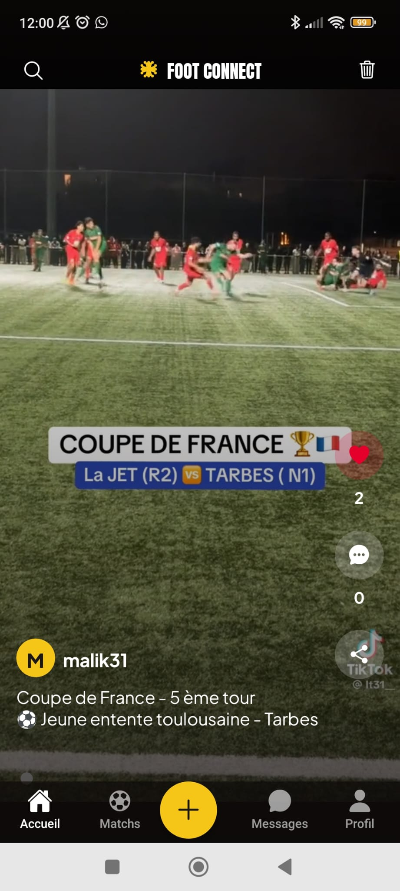
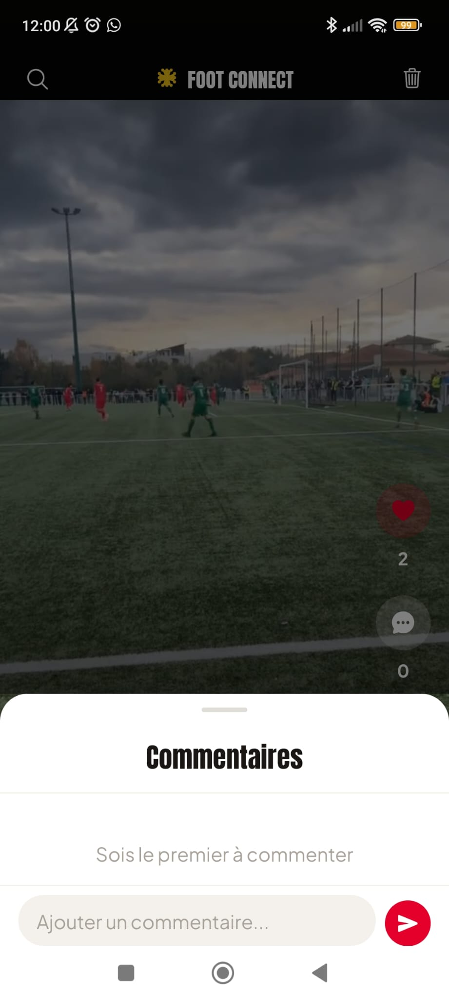
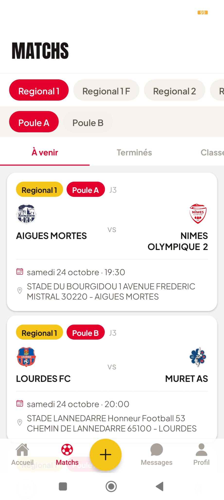
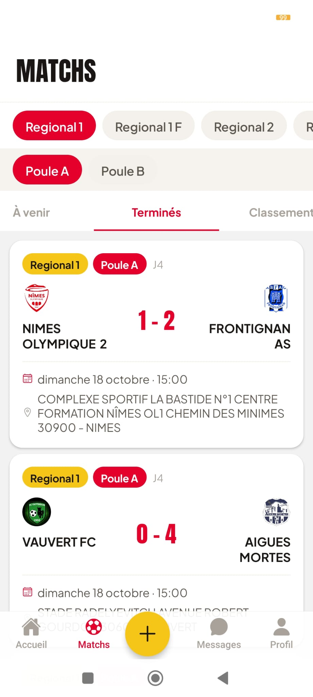
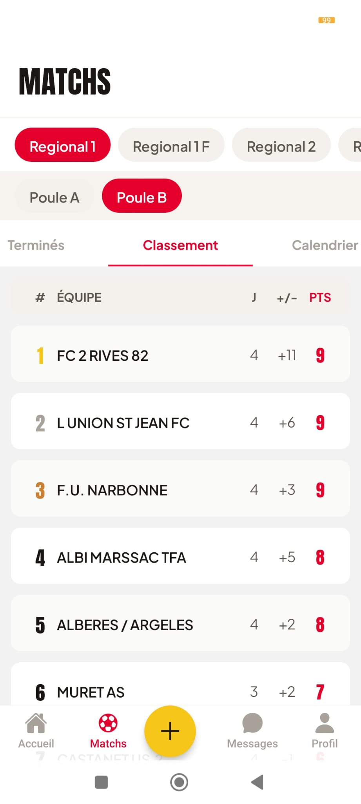
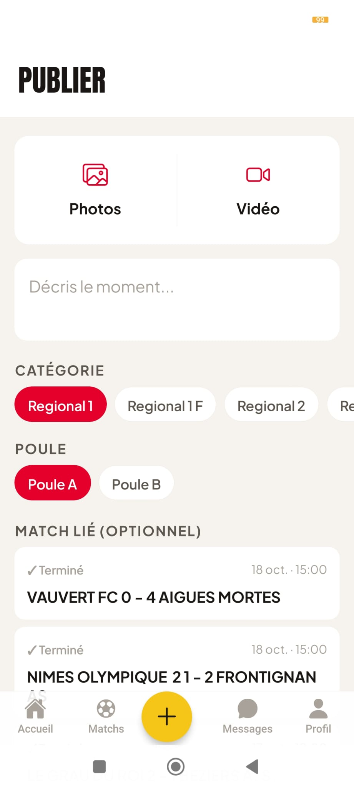
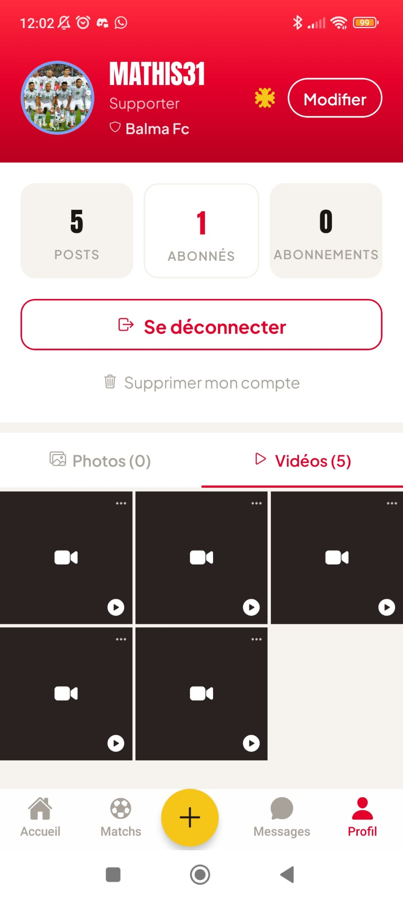
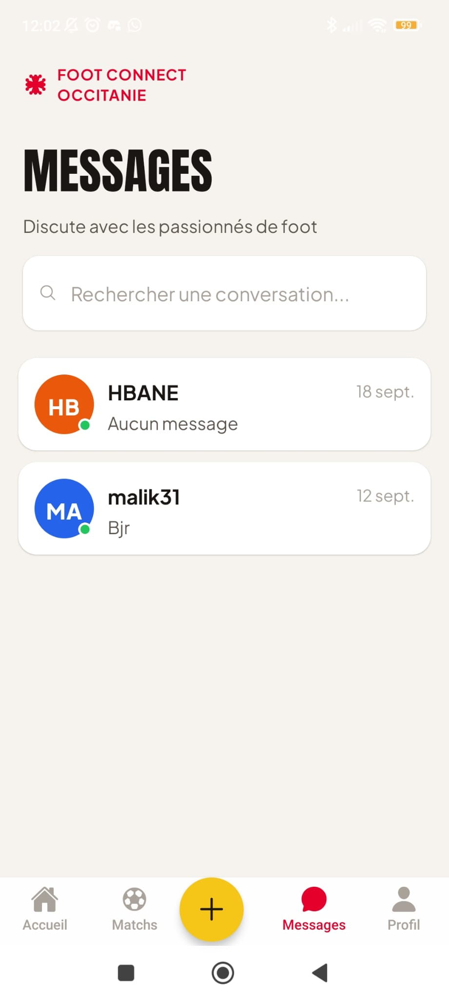

# Foot Connect Occitanie

Application mobile dédiée au football amateur en Occitanie : suivi sportif (matchs, résultats, classements) et réseau social (posts photo/vidéo, likes, commentaires, follow, messagerie privée). Les administrateurs gèrent le contenu sportif et la modération depuis un back-office web.

- **Mobile** : iOS (App Store) et Android (Play Store)
- **Production** : <https://footconnect-occitanie.fr>

## Aperçu

<table>
  <tr>
    <td width="25%"></td>
    <td width="25%"></td>
    <td width="25%"></td>
    <td width="25%"></td>
  </tr>
  <tr>
    <td width="25%" align="center">Feed vidéo</td>
    <td width="25%" align="center">Commentaires</td>
    <td width="25%" align="center">Matchs à venir</td>
    <td width="25%" align="center">Résultats</td>
  </tr>
  <tr>
    <td width="25%"></td>
    <td width="25%"></td>
    <td width="25%"></td>
    <td width="25%"></td>
  </tr>
  <tr>
    <td width="25%" align="center">Classement</td>
    <td width="25%" align="center">Publier un post</td>
    <td width="25%" align="center">Profil</td>
    <td width="25%" align="center">Messagerie</td>
  </tr>
</table>

## Stack technique

### Mobile — `mobile/`

| Brique | Technologie |
|--------|-------------|
| Framework | React Native 0.81 + Expo SDK 54 (React 19.1) |
| Navigation | React Navigation 7 (bottom tabs, top tabs, native stack) |
| Appels API | axios |
| Stockage tokens JWT | expo-secure-store |
| Médias | expo-image-picker, expo-video |
| UI | expo-linear-gradient, react-native-svg, polices Anton + Plus Jakarta Sans |
| Build & stores | Expo EAS (+ Codemagic pour iOS, voir `codemagic.yaml`) |

### Back-office admin — `admin-panel/`

| Brique | Technologie |
|--------|-------------|
| Framework | React 19 + Vite 8 |
| Routing | React Router 7 |
| Appels API | axios |
| Lint | ESLint 9 |

### Backend — `backend/`

| Brique | Technologie |
|--------|-------------|
| API | Django 6.0 + Django REST Framework 3.17 |
| Authentification | JWT (djangorestframework-simplejwt) |
| Base de données | PostgreSQL 16 |
| Tâches asynchrones | Celery 5.6 + Redis (broker) + Celery Beat (planificateur) |
| Stockage médias | Cloudflare R2 (via boto3, URLs pré-signées) |
| Emails | Resend |
| Config | python-decouple (`.env`) |

Apps Django : `users`, `clubs`, `teams`, `matches`, `standings`, `scraper`, `posts`, `interactions`, `messaging`.

### Infrastructure de production

| Brique | Technologie |
|--------|-------------|
| Serveur | VPS Hetzner (Ubuntu) |
| Reverse proxy | Nginx |
| HTTPS | Let's Encrypt (Certbot) |
| Serveur WSGI | Gunicorn (systemd) |
| Services | PostgreSQL, Redis, Celery Worker, Celery Beat (systemd) |
| Back-office | Build statique servi par Nginx |

## Upload des médias (Cloudflare R2)

Les fichiers ne transitent jamais par Django :

1. Le mobile demande une URL d'upload : `POST /api/media/presign/`
2. Le backend génère une URL pré-signée vers le bucket R2 (`foot-connect-media`)
3. Le mobile envoie le fichier directement sur R2 (`PUT`)
4. L'URL publique du fichier est enregistrée dans le post ou le profil

> Cloudinary a été remplacé par Cloudflare R2 (Sprint 7) pour des raisons de coût.

## Données sportives

Le scraper de l'API FFF (`api-dofa.fff.fr`) est bloqué depuis juin 2026 (protection JavaScript). En attendant, les calendriers sont exportés manuellement depuis le site FFF et importés avec :

```bash
python manage.py import_calendar <fichier.txt>
python manage.py merge_duplicate_clubs   # fusionne les clubs en doublon après import
```

## Lancer le projet en local

### Backend (Docker)

Créer `backend/.env` puis :

```bash
docker compose up --build
```

Services lancés : `web` (Django, port 8000), `db` (PostgreSQL), `redis`, `celery_worker`, `celery_beat`.

```bash
docker compose exec web python manage.py migrate
docker compose exec web python manage.py createsuperuser
```

### Back-office

```bash
cd admin-panel
npm install
npm run dev
```

### Mobile

```bash
cd mobile
npm install
npm start
```

## Variables d'environnement (`backend/.env`)

```env
SECRET_KEY=
DEBUG=
ALLOWED_HOSTS=
DATABASE_URL=
REDIS_URL=
FFF_API_BASE_URL=
FFF_REGION_CODE=
RESEND_API_KEY=
R2_ACCOUNT_ID=
R2_ACCESS_KEY_ID=
R2_SECRET_ACCESS_KEY=
R2_BUCKET_NAME=
R2_PUBLIC_URL=
```

## Mise à jour en production

```bash
cd /opt/foot-connect
git pull origin main
source venv/bin/activate
cd backend
pip install -r requirements.txt
python manage.py migrate
python manage.py collectstatic --noinput
sudo systemctl restart gunicorn celery celerybeat
```

## Documentation

- `CLAUDE.md` : cadrage produit, modèle de données, contrat API, architecture
- `docs/` : documentation par sprint
- `Design/` : maquettes et design tokens
