# Foot Connect Occitanie — Spécification fonctionnelle et technique

Projet Portfolio de fin d'année — Holberton School · Malik Bouanani

## 0. Priorisation des fonctionnalités

**Méthode de priorisation :** j'utilise la méthode MoSCoW, car elle sépare clairement ce qui est indispensable au MVP de ce qui peut attendre. Le critère principal est simple : une fonctionnalité est « Must Have » si, sans elle, un utilisateur ne peut pas suivre son match et en partager les images, ou si l'application ne peut pas être publiée sur les stores.

Comme le projet existe déjà, chaque fonctionnalité indique son statut : **Livré** (en production sur l'App Store et le Google Play Store) ou **V1** (prévu pendant la période Portfolio).

### Must Have — indispensable au MVP

| Fonctionnalité | Pourquoi c'est indispensable | Statut |
| --- | --- | --- |
| Inscription avec acceptation des CGU, connexion, déconnexion | Sans compte, pas de publication ni d'interaction ; CGU exigées par Apple | Livré |
| Mot de passe oublié (code de réinitialisation par email) | Un utilisateur qui oublie son mot de passe perd son compte | Livré |
| Vérification du compte par email (code à 6 chiffres à l'inscription) | Fonctionnalité obligatoire Holberton ; évite les comptes avec une adresse fausse | V1 |
| Changement du mot de passe depuis le profil (ancien + nouveau) | Fonctionnalité obligatoire Holberton ; un utilisateur connecté doit pouvoir sécuriser son compte | V1 |
| Page Matchs : onglets À venir, Terminés, Classement, Calendrier | Cœur du besoin : retrouver le match et le score de son équipe | Livré |
| Filtres catégorie, poule et saison | Plus de 5 000 matchs : sans filtre, la page est inutilisable | Livré |
| Publier un post (photos en carrousel ou vidéo) rattaché à un match : choisi dans la liste, ou saisi à la main (équipe à domicile et à l'extérieur) si le match n'y est pas | Cœur de la proposition de valeur : relier les images au match | Livré |
| Rendre l'indication du match obligatoire, dans l'appli et sur le serveur | Aujourd'hui, un post peut être publié sans match : correctif nécessaire pour tenir la promesse du produit | V1 |
| Fil d'actualité et page détail d'un post | Voir les publications des autres | Livré |
| Liker et commenter un post | Interaction minimale d'un réseau social | Livré |
| Signaler un post ou un commentaire, bloquer un utilisateur | Exigé par Apple pour une appli avec contenu publié par les utilisateurs (guideline 1.2) | Livré |
| Supprimer son compte depuis l'application | Exigé par Apple (guideline 5.1.1) et par le RGPD | Livré |
| Back-office admin : gestion des clubs, équipes et matchs | Les données FFF doivent être importées et corrigées à la main | Livré |
| Back-office admin : saisie et correction des scores, recalcul du classement | Un classement faux enlève toute confiance dans l'appli | Livré |
| Back-office admin : modération (signalements, posts, utilisateurs) | Obligation de traiter les signalements | Livré |
| Import des calendriers FFF exportés (script `import_calendar`) | Aucune API FFF disponible : c'est la seule source des calendriers | Livré |

### Should Have — important, mais l'appli fonctionne sans

| Fonctionnalité | Statut |
| --- | --- |
| Profil utilisateur avec grille de ses publications, modification du nom, du rôle sportif et de l'avatar | Livré |
| Suivre / ne plus suivre un utilisateur, listes d'abonnés et d'abonnements | Livré |
| Messagerie privée entre deux utilisateurs, avec statut lu / non lu | Livré |
| Recherche d'utilisateurs et de posts (par équipe ou auteur) | Livré |
| Page Statistiques du back-office (utilisateurs actifs, inscrits, contenu) | Livré |
| Notifications push : nouveau like, commentaire, message, abonné | V1 |
| Saisie du score d'un match par les coachs et dirigeants, validée par l'admin | V1 |
| Tests automatiques du back-end complets et intégration continue sur GitHub | V1 |
| Sauvegarde quotidienne de la base de données hors du serveur | V1 |
| Session prolongée : rester connecté tant que l'appli est utilisée au moins une fois tous les 7 jours (renouvellement automatique du jeton de rafraîchissement) | V1 |

### Could Have — souhaitable si le temps le permet

| Fonctionnalité | Statut |
| --- | --- |
| Partage d'un post vers d'autres applis (WhatsApp, SMS…) | Livré |
| Réponses aux commentaires et likes sur les commentaires | Livré |
| Suivre une équipe favorite et être notifié de ses résultats | Futur |
| Espace club vérifié : un dirigeant gère la page de son club | Futur |
| Repost interne d'une publication dans son fil | Futur |
| Statistiques détaillées par équipe (buts, séries de victoires) | Futur |
| Compression des vidéos sur le téléphone avant l'envoi (envoi plus rapide en 4G, moins de stockage) | Futur |

### Won't Have for now — exclu de cette version

| Fonctionnalité | Raison |
| --- | --- |
| Synchronisation automatique avec l'API FFF | La FFF a refusé par écrit d'ouvrir ses API aux clubs ; contourner sa protection est exclu |
| Diffusion vidéo en direct | Coût d'infrastructure et modération en temps réel trop lourds pour un développeur seul |
| Score minute par minute pendant le match | Demande des saisisseurs présents en continu au bord du terrain |
| Chat de groupe | La messagerie à deux suffit au besoin identifié |
| Paiement, boutique, abonnement payant | L'appli reste gratuite ; aucun besoin identifié |
| Site web public pour les utilisateurs | L'usage est mobile ; le web est réservé à l'administration |
| Autres régions que l'Occitanie | Les données de chaque ligue doivent être importées à la main |
| Recommandations par intelligence artificielle | Pas assez d'utilisateurs et de contenus pour que ce soit utile |

### Définition du MVP

Le MVP est complet si un utilisateur peut créer un compte, trouver le match de son équipe avec son score et son classement, publier une photo ou une vidéo liée à ce match, voir et commenter les publications des autres, signaler un contenu et supprimer son compte. De son côté, l'administrateur doit pouvoir importer les calendriers, corriger un score (le classement se met à jour) et retirer un contenu signalé.

Ce MVP est **atteint pour l'usage réel** : les fonctionnalités « Must Have » qui portent le besoin des utilisateurs sont livrées et publiées sur les deux stores. Deux « Must Have » restent à livrer en V1 car elles sont exigées par Holberton : la vérification du compte par email et le changement de mot de passe. La période Portfolio porte sur toutes les fonctionnalités marquées **V1**.

## 1. User stories et fonctionnalités minimales

### 1.1 Fonctionnalités obligatoires Holberton

| Fonctionnalité obligatoire | Dans Foot Connect Occitanie | Statut |
| --- | --- | --- |
| Inscription | Formulaire nom d'utilisateur, email, mot de passe, case CGU obligatoire | Livré |
| Connexion | Email + mot de passe | Livré |
| Déconnexion | Bouton « Se déconnecter » dans le profil, suppression des jetons sur le téléphone | Livré |
| Vérification du compte par email ou SMS | Code à 6 chiffres envoyé par email à l'inscription, compte limité tant qu'il n'est pas vérifié | V1 |
| Changement du mot de passe | Réinitialisation par code email (livré) ; changement depuis le profil avec l'ancien mot de passe (V1) | Partiel → V1 |
| Authentification sécurisée | JWT (bibliothèque SimpleJWT) : jeton d'accès de 8 h + jeton de rafraîchissement de 7 jours, mots de passe hachés par Django | Livré |
| CRUD liés au contexte | Posts (créer, lire, supprimer), commentaires (créer, lire, supprimer), profil (lire, modifier, supprimer), clubs, équipes et matchs dans le back-office (CRUD complet) | Livré |
| Au moins 1 API ou service externe | Resend (envoi d'emails), Cloudflare R2 (stockage des photos et vidéos via l'API compatible S3), Expo Push (notifications, V1) | Livré |

### 1.2 Fonctionnalités complémentaires (minimum 10)

Seize fonctionnalités de la liste Holberton sont déjà livrées, et une est prévue en V1.

| Catégorie Holberton | Fonctionnalité | Statut |
| --- | --- | --- |
| Communication et interaction | Messagerie interne (chat entre deux utilisateurs) | Livré |
| Communication et interaction | Commentaires (avec réponses et likes) | Livré |
| Communication et interaction | Partage de contenu (vers WhatsApp, SMS…) | Livré |
| Communication et interaction | Notifications push | V1 |
| Gestion de contenu | Upload de fichiers (photos et vidéos) | Livré |
| Gestion de contenu | Gestion d'images et de vidéos (carrousel de photos, lecture vidéo, miniatures) | Livré |
| Navigation et consultation | Tableau de bord (back-office : statistiques et supervision) | Livré |
| Recherche | Recherche textuelle (utilisateurs, posts par équipe ou auteur) | Livré |
| Recherche | Filtrage des résultats (catégorie, poule, saison, statut du match) | Livré |
| Réseaux sociaux | Abonnements (suivre / ne plus suivre) | Livré |
| Réseaux sociaux | Likes | Livré |
| Réseaux sociaux | Fil d'actualité | Livré |
| Réseaux sociaux | Signalement de contenu | Livré |
| Réseaux sociaux | Modération de contenu | Livré |
| Autres | Calendrier (calendrier complet des journées de championnat) | Livré |
| Autres | Rapports et statistiques (page Stats du back-office) | Livré |
| Autres | Consentement RGPD (acceptation des CGU à l'inscription) | Livré |
| Autres | Suppression du compte utilisateur | Livré |

### 1.3 User stories

Format : « En tant que [utilisateur], je veux [objectif], afin de [bénéfice] ». Chaque story renvoie à une fonctionnalité de la section 0 (priorité entre crochets). Les critères d'acceptation suivent le format « Étant donné… quand… alors… ».

**Compte et sécurité**

**US1 — Créer un compte** [Must]
En tant que parent, je veux créer un compte afin de publier les photos du match de mon enfant.

- Étant donné que je suis sur l'écran d'inscription, quand je saisis un nom d'utilisateur, un email et un mot de passe valides et que je coche les CGU, alors mon compte est créé.
- Étant donné que je n'ai pas coché les CGU, quand je valide, alors l'inscription est bloquée avec le message « Tu dois accepter les conditions d'utilisation ».
- Étant donné que l'email est déjà utilisé, quand je valide, alors un message d'erreur clair s'affiche.
- Étant donné que le mot de passe est trop court ou trop courant, quand je valide, alors le système explique les règles du mot de passe.

**US2 — Vérifier mon adresse email** [Must, V1]
En tant que nouvel utilisateur, je veux confirmer mon adresse email afin que mon compte soit reconnu comme authentique.

- Étant donné que je viens de m'inscrire, quand l'inscription est validée, alors je reçois un email contenant un code à 6 chiffres valable 15 minutes.
- Étant donné que je saisis le bon code, quand je valide, alors mon compte est marqué comme vérifié.
- Étant donné que le code est faux ou expiré, quand je valide, alors un message d'erreur s'affiche et je peux demander un nouveau code.
- Étant donné que mon compte n'est pas vérifié, quand j'essaie de publier, alors l'appli me demande d'abord de vérifier mon email.

**US3 — Me connecter et me déconnecter** [Must]
En tant qu'utilisateur, je veux me connecter et me déconnecter afin d'accéder à mon compte en sécurité, même sur un téléphone partagé.

- Étant donné un email et un mot de passe corrects, quand je me connecte, alors j'arrive sur le fil d'actualité.
- Étant donné un mot de passe faux, quand je me connecte, alors un message d'erreur s'affiche sans préciser si c'est l'email ou le mot de passe qui est faux.
- Étant donné que je suis connecté, quand j'appuie sur « Se déconnecter », alors je reviens à l'écran de connexion et mes jetons sont effacés du téléphone.

**US4 — Réinitialiser ou changer mon mot de passe** [Must]
En tant qu'utilisateur, je veux réinitialiser mon mot de passe oublié ou le changer depuis mon profil afin de garder l'accès à mon compte.

- Étant donné que j'ai oublié mon mot de passe, quand je saisis mon email, alors je reçois un code valable 15 minutes, et le message affiché est le même que l'email existe ou non.
- Étant donné un code valide, quand je saisis un nouveau mot de passe, alors je peux me connecter avec ce nouveau mot de passe.
- (V1) Étant donné que je suis connecté, quand je saisis mon ancien mot de passe correct et un nouveau mot de passe valide, alors mon mot de passe est changé.
- (V1) Étant donné un ancien mot de passe faux, quand je valide, alors le changement est refusé.

**US5 — Supprimer mon compte** [Must]
En tant qu'utilisateur, je veux supprimer mon compte depuis l'appli afin que mes données personnelles soient effacées.

- Étant donné que je suis dans « Modifier le profil », quand je choisis « Supprimer mon compte » et que je confirme, alors mon compte, mes posts, commentaires et messages sont supprimés et je suis déconnecté.

**Suivi sportif**

**US6 — Consulter les matchs de mon équipe** [Must]
En tant que supporter, je veux voir les matchs à venir et terminés de ma catégorie et de ma poule afin de savoir quand joue mon équipe et quel a été le score.

- Étant donné que je choisis une catégorie, une poule et une saison, quand j'ouvre l'onglet « À venir », alors je vois les matchs programmés avec la date, l'heure (heure de Paris) et le lieu.
- Étant donné les mêmes filtres, quand j'ouvre l'onglet « Terminés », alors je vois les matchs joués avec leur score final.
- Étant donné que je change un filtre, quand je reviens sur un onglet, alors son contenu correspond aux nouveaux filtres.

**US7 — Consulter le classement et le calendrier** [Must]
En tant que joueur, je veux voir le classement et le calendrier complet de ma poule afin de savoir où se situe mon équipe.

- Étant donné une poule choisie, quand j'ouvre l'onglet « Classement », alors je vois le rang, les points, les matchs joués, gagnés, nuls, perdus et la différence de buts de chaque équipe.
- Étant donné deux équipes à égalité de points, alors leur ordre suit la règle de la confrontation directe.
- Étant donné une poule choisie, quand j'ouvre l'onglet « Calendrier », alors je vois toutes les journées, de la première à la dernière.

**Publication et réseau social**

**US8 — Publier les photos ou la vidéo d'un match** [Must]
En tant que parent, je veux publier des photos ou une vidéo rattachées à un match afin que les autres familles les retrouvent à partir du score.

- Étant donné que je suis connecté, quand je choisis un match dans la liste (à venir ou terminés), ajoute une ou plusieurs photos (ou une vidéo) et une légende, puis publie, alors le post apparaît dans le fil et sur mon profil, avec le match concerné.
- Étant donné que mon match n'est pas dans la liste, quand je coche « Mon match n'est pas dans la liste » et saisis l'équipe à domicile et l'équipe à l'extérieur, alors le post est publié avec ces deux équipes.
- (V1) Étant donné que je n'ai ni choisi un match ni saisi les deux équipes, quand je publie, alors la publication est refusée avec le message « Choisis un match ou indique les deux équipes ».
- Étant donné une vidéo, quand je la publie, alors elle est envoyée sur le stockage en ligne et lue dans l'appli.

**US9 — Consulter le fil et réagir** [Must]
En tant que supporter, je veux voir les dernières publications, les liker et les commenter afin de partager l'ambiance du match.

- Étant donné que j'ouvre l'accueil, alors je vois les publications les plus récentes en premier.
- Étant donné un post, quand j'appuie sur le cœur, alors le like est ajouté, et un second appui le retire ; le compteur se met à jour.
- Étant donné un post, quand j'écris un commentaire, alors il apparaît sous le post ; je peux supprimer uniquement mes propres commentaires (l'appli ne propose pas de modifier un commentaire).

**US10 — Suivre d'autres utilisateurs** [Should]
En tant que joueur, je veux suivre d'autres joueurs et parents afin de retrouver facilement leurs publications.

- Étant donné le profil d'un autre utilisateur, quand j'appuie sur « Suivre », alors son nombre d'abonnés augmente de 1 et le bouton devient « Ne plus suivre ».
- Étant donné que je le suis déjà, quand j'appuie de nouveau, alors je ne le suis plus.
- Étant donné mon profil, quand j'appuie sur mes abonnés ou mes abonnements, alors j'en vois la liste.

**US11 — Envoyer un message privé** [Should]
En tant que coach, je veux envoyer un message privé à un parent afin de lui demander une photo du match.

- Étant donné le profil d'un utilisateur, quand j'ouvre une conversation et envoie un message, alors il apparaît dans la conversation des deux utilisateurs.
- Étant donné que j'ouvre une conversation, alors les messages reçus passent en « lus » et le compteur de non lus revient à 0.

**US12 — Rechercher** [Should]
En tant que parent, je veux rechercher un utilisateur ou une équipe afin de retrouver vite les publications qui m'intéressent.

- Étant donné que je tape un mot dans la recherche, alors je vois les utilisateurs dont le nom correspond et les posts dont l'équipe ou l'auteur correspond.

**US13 — Signaler un contenu et bloquer un utilisateur** [Must]
En tant que parent, je veux signaler une publication inappropriée et bloquer son auteur afin de protéger mon enfant.

- Étant donné un post, quand je choisis « Signaler » et un motif (spam, contenu inapproprié, harcèlement, autre), alors le signalement apparaît dans la modération du back-office.
- Étant donné le profil d'un utilisateur, quand je le bloque, alors je ne vois plus ses publications.

**US14 — Être notifié des interactions** [Should, V1]
En tant que joueur, je veux recevoir une notification quand quelqu'un like, commente, m'envoie un message ou s'abonne à moi afin de réagir rapidement.

- Étant donné que j'ai autorisé les notifications, quand un autre utilisateur like mon post, alors je reçois une notification push en moins d'une minute.
- Étant donné que j'appuie sur la notification, alors l'appli s'ouvre sur le post, le profil ou la conversation concernée.
- Étant donné que j'ai refusé les notifications, alors l'appli fonctionne normalement sans en envoyer.

**Administration**

**US15 — Gérer les données sportives** [Must]
En tant qu'administrateur, je veux importer les calendriers et créer, modifier ou supprimer clubs, équipes et matchs afin que les données de l'appli soient complètes et justes.

- Étant donné un fichier de calendrier exporté du site de la FFF, quand je lance l'import, alors les clubs, équipes et matchs manquants sont créés sans doublon.
- Étant donné un match, quand je modifie sa date ou son lieu, alors l'heure saisie est l'heure de Paris et s'affiche à l'identique dans l'appli.

**US16 — Saisir un score** [Must]
En tant qu'administrateur, je veux saisir ou corriger le score d'un match afin que le classement soit à jour.

- Étant donné un match, quand je saisis le score, alors le match passe en « terminé », il est verrouillé et le classement de la poule est recalculé.

**US17 — Proposer le score de mon match** [Should, V1]
En tant que coach, je veux saisir le score du match de mon équipe afin que les résultats soient publiés rapidement, sans attendre l'administrateur.

- Étant donné que mon compte est « coach » ou « dirigeant », quand je propose un score pour un match terminé de mon équipe, alors il apparaît « en attente de validation » dans le back-office.
- Étant donné que l'administrateur valide le score, alors il s'affiche dans l'appli et le classement est recalculé.

**US18 — Modérer et suivre l'activité** [Must]
En tant qu'administrateur, je veux traiter les signalements et suivre l'utilisation de l'appli afin de garder une communauté sûre et de mesurer son adoption.

- Étant donné un signalement, quand je supprime le contenu ou ignore le signalement, alors il disparaît de la liste « en attente ».
- Étant donné un utilisateur abusif, quand je le bannis, alors il ne peut plus se connecter.
- Étant donné la page Stats, alors je vois le nombre d'utilisateurs actifs par jour, d'inscrits et de publications sur 30 jours.

## 2. Exigences non fonctionnelles

Chaque exigence indique comment elle est mise en œuvre, son statut (**En place** ou **V1**) et comment la vérifier. Les statuts « En place » ont été contrôlés dans le code et sur le serveur de production le 26/11/2026.

### 2.1 Sécurité — mesures obligatoires Holberton

| Mesure | Mise en œuvre dans Foot Connect Occitanie | Statut | Vérification |
| --- | --- | --- | --- |
| Protection contre l'injection SQL | Toutes les requêtes passent par l'ORM de Django, qui utilise des requêtes paramétrées. Aucune requête SQL écrite à la main (aucun `raw()`, `execute()` ni `extra()` dans le code). Les entrées sont validées par les serializers de Django REST Framework | En place | Recherche de `raw(`, `execute(` dans le dépôt : aucun résultat |
| Hachage des mots de passe | Algorithme PBKDF2-SHA256 de Django, avec un sel unique par utilisateur et plus d'un million d'itérations. Les codes de réinitialisation expirent après 15 minutes | En place | Colonne `password` de la table `users_user` : format `pbkdf2_sha256$…` |
| Chiffrement en transit | HTTPS (TLS) pour toutes les communications entre l'appli, le back-office et l'API, ainsi qu'avec Cloudflare R2 et Resend | En place | Navigateur : cadenas valide sur footconnect-occitanie.fr |
| Chiffrement au repos | Photos et vidéos chiffrées en AES-256 par Cloudflare R2. Les clés et secrets (clé Django, accès R2, clé Resend, base de données) sont dans un fichier `.env` sur le serveur, jamais dans le code. Sauvegardes de la base chiffrées en AES-256 (GPG) avant envoi hors du serveur | En place (médias, secrets) / V1 (sauvegardes) | `.env` présent dans `.gitignore` ; aucun secret dans l'historique Git |
| HTTPS obligatoire | Certificat Let's Encrypt renouvelé automatiquement (Certbot). Nginx redirige tout le trafic HTTP vers HTTPS (code 301) | En place | `http://footconnect-occitanie.fr` renvoie un 301 vers `https://` |
| Cookies sécurisés et HSTS | L'appli s'authentifie par jeton JWT (pas de cookie). Pour l'admin Django : cookies `Secure` et `HttpOnly`, en-tête HSTS d'un an, en-têtes anti-clickjacking et anti-sniffing | V1 | En-têtes de réponse visibles dans les outils développeur du navigateur |
| Recommandations CNIL sur les mots de passe | 12 caractères minimum avec au moins 3 types de caractères (majuscule, minuscule, chiffre, caractère spécial), refus des mots de passe courants ; mêmes règles à l'inscription, à la réinitialisation et au changement de mot de passe | V1 (aujourd'hui : 8 caractères à l'inscription, 6 à la réinitialisation) | Tests automatiques sur chaque formulaire |
| Protection contre la force brute | Limitation du nombre de requêtes sur la connexion, l'inscription et le mot de passe oublié (5 essais par minute) ; blocage temporaire du compte pendant 15 minutes après 5 échecs de connexion | V1 | Test automatique : la 6e tentative renvoie une erreur 429 |

### 2.2 Sécurité — autres mesures

| Mesure | Mise en œuvre | Statut |
| --- | --- | --- |
| Authentification | JWT : jeton d'accès de 8 h gardé en mémoire, jeton de rafraîchissement de 7 jours stocké de façon chiffrée sur le téléphone (SecureStore d'Expo, qui s'appuie sur le trousseau iOS et le Keystore Android) | En place |
| Durée de session | Aujourd'hui, l'utilisateur doit se reconnecter 7 jours après sa dernière connexion avec mot de passe, même s'il utilise l'appli chaque jour. En V1 : rotation du jeton de rafraîchissement (`ROTATE_REFRESH_TOKENS` de SimpleJWT, ancien jeton mis sur liste noire) et enregistrement du nouveau jeton par l'appli : la session n'expire qu'après 7 jours sans utilisation | V1 |
| Autorisation | Toutes les routes exigent d'être connecté, sauf l'inscription, la connexion et la consultation des matchs, classements et posts. Les routes d'administration vérifient le rôle `admin` (réponse 403 sinon). Un utilisateur ne peut supprimer que ses propres posts et commentaires | En place |
| Autorisation (correctifs) | Modification d'un commentaire réservée à son auteur ; email retiré du profil public (bugs B03 et B04, section 7.11) | Corrigé, testé |
| Envoi de fichiers | Le téléphone envoie les médias directement sur Cloudflare R2 grâce à une URL signée valable 1 heure, générée par l'API. Les clés R2 ne quittent jamais le serveur | En place |
| Fuite d'informations | « Mot de passe oublié » répond le même message que l'email existe ou non ; l'erreur de connexion ne dit pas si l'email ou le mot de passe est faux ; `DEBUG` désactivé en production | En place |
| CORS | Seuls le domaine de production et l'environnement de développement local peuvent appeler l'API depuis un navigateur | En place |
| Serveur | Pare-feu UFW limité aux ports 22, 80 et 443 ; mises à jour de sécurité automatiques ; connexion SSH par clé | En place |
| Serveur (renforcement) | Désactivation de la connexion SSH par mot de passe ; Fail2ban pour bannir les IP qui tentent de se connecter en boucle | V1 |
| Données personnelles (RGPD) | Collecte minimale (nom d'utilisateur, email, avatar facultatif) ; consentement aux CGU à l'inscription ; suppression du compte et de toutes ses données depuis l'appli | En place |

### 2.3 Performance

- L'API répond en moins de 500 ms pour le fil d'actualité et la liste des matchs d'une poule, mesuré depuis la France.
- Aujourd'hui, le fil d'actualité et les listes de matchs sont renvoyés en une seule réponse ; en V1, le fil sera paginé par 20 posts (chargement de la suite en faisant défiler) et les listes de matchs par 50.
- Les photos sont légèrement compressées avant l'envoi (qualité 80 %) et chaque vidéo est limitée à 100 Mo, avec un message clair si elle dépasse cette taille. La durée des vidéos n'est pas limitée aujourd'hui ; en amélioration prévue (Could Have), les vidéos seront compressées sur le téléphone avant l'envoi pour réduire le temps d'envoi en 4G et le coût de stockage.
- Les fichiers médias sont servis directement par Cloudflare R2, sans passer par le serveur de l'API.

### 2.4 Responsive design

- L'application mobile fonctionne sur iPhone et Android, des petits écrans (iPhone SE) aux grands écrans, en mode portrait.
- Le clavier ne masque jamais le champ de saisie dans la messagerie (Android et iOS).
- Le back-office est utilisable sur ordinateur, tablette et téléphone : menu adapté aux petits écrans et tableaux défilant horizontalement.

### 2.5 Accessibilité

- Les textes respectent un contraste suffisant (texte foncé `#1A1614` sur fond clair `#F6F3EE`).
- Les zones tactiles des boutons font au moins 44 × 44 points, comme le recommandent Apple et Google.
- Chaque champ de formulaire a un libellé visible, et les messages d'erreur sont rédigés en français clair.
- Les icônes sans texte (like, commentaire, partage, recherche) ont une étiquette d'accessibilité lue par VoiceOver et TalkBack (V1).

### 2.6 Intégrité des données

- Un utilisateur ne peut liker un post qu'une seule fois et suivre un utilisateur qu'une seule fois (contraintes d'unicité en base).
- Un post est rattaché à un match existant ou à deux équipes saisies à la main ; un identifiant de match inexistant est refusé (contrôle côté serveur en V1).
- La suppression d'un compte supprime en cascade ses posts, médias, commentaires, likes, abonnements et messages : aucune donnée orpheline.
- Un score corrigé par l'administrateur verrouille le match, pour qu'un import ultérieur ne l'écrase pas ; le classement est recalculé à chaque nouveau score.
- Les dates des matchs sont stockées en UTC et affichées à l'heure de Paris, dans l'appli comme dans le back-office.
- Chaque modification du modèle de données passe par une migration Django versionnée dans Git.

### 2.7 Gestion des erreurs

- L'API renvoie des erreurs au format JSON avec un code HTTP adapté : 400 (données invalides), 401 (non connecté), 403 (accès interdit), 404 (introuvable), 429 (trop de tentatives, V1), 500 (erreur serveur).
- L'appli n'affiche jamais d'erreur technique brute : l'utilisateur voit un message en français (« Impossible de publier, vérifie ta connexion »).
- À l'ouverture de l'appli, le jeton d'accès est renouvelé automatiquement avec le jeton de rafraîchissement ; si celui-ci a expiré, l'utilisateur est renvoyé vers la connexion (en place). Le même renouvellement se fera aussi en cours d'utilisation, dès qu'une requête reçoit une erreur 401 (V1).
- Un échec de l'envoi d'email (Resend) ou des statistiques ne bloque jamais l'action de l'utilisateur.

### 2.8 Maintenabilité

- Le back-end est découpé en applications Django par domaine : `users`, `clubs`, `teams`, `matches`, `standings`, `posts`, `interactions`, `messaging`, `scraper`.
- L'appli mobile sépare les écrans (`screens/`), le contexte d'authentification (`context/`) et l'accès à l'API.
- Toute la configuration passe par des variables d'environnement ; le même code tourne en local (Docker) et en production.
- Le code et les commentaires suivent des conventions homogènes ; chaque fonctionnalité fait l'objet de commits clairs.
- Tests automatiques du back-end (87 tests) lancés à chaque pull request par l'intégration continue GitHub Actions (en place).

### 2.9 Sauvegarde et reprise

- **Constat :** le 17/11/2026, une panne matérielle chez Hetzner a rendu le serveur inaccessible plusieurs heures. Aucune sauvegarde de la base n'existait.
- Sauvegarde automatique quotidienne de la base PostgreSQL (`pg_dump`), chiffrée en AES-256, envoyée hors du serveur sur Cloudflare R2, conservée 30 jours (V1).
- Sauvegardes Hetzner du serveur complet, quotidiennes, conservées 7 jours (V1).
- Procédure de restauration écrite et testée au moins une fois : objectif de remise en service en moins de 2 heures, avec au maximum 24 heures de données perdues (V1).

### 2.10 Journalisation et supervision

- Django enregistre les avertissements et erreurs dans `backend/logs/django.log` (en place).
- Nginx enregistre chaque requête (accès et erreurs) (en place).
- La page Stats du back-office suit les utilisateurs actifs par jour, les inscriptions et les publications (en place).
- Alerte automatique (email) si l'API ne répond plus pendant plus de 5 minutes, via un service de surveillance externe gratuit (V1).

## 3. Stack technique et architecture de l'application

### 3.1 Stack technique et justification des choix

| Couche | Technologie | Pourquoi ce choix |
| --- | --- | --- |
| Application mobile | React Native 0.81 + Expo SDK 54 (React 19) | Un seul code JavaScript pour iOS et Android ; Expo simplifie l'accès à l'appareil photo, à la galerie et au stockage sécurisé, et compile les applis dans le cloud (EAS Build) sans Mac obligatoire |
| Navigation mobile | React Navigation 7 (onglets en bas, onglets en haut, piles d'écrans) | Standard de React Native ; barre de navigation à 5 onglets avec le bouton « Publier » central |
| Interface mobile | Composants React Native natifs, `StyleSheet`, polices Google Anton et Plus Jakarta Sans, dégradés `expo-linear-gradient`, lecture vidéo `expo-video` | Interface moderne inspirée d'Instagram et TikTok (fil plein écran, carrousel) avec une charte graphique propre (rouge occitan `#E4002B`, or `#F5C518`), sans dépendre d'une bibliothèque d'interface lourde |
| Back-office admin | React 19 + Vite 8 + React Router 7 + Axios | Même langage que l'appli mobile ; Vite compile en quelques secondes ; le résultat est un site statique servi directement par Nginx |
| Back-end / API | Python 3.14, Django 6 + Django REST Framework 3.17 | Django fournit l'ORM (protection contre l'injection SQL), le hachage des mots de passe, les migrations et l'admin ; DRF ajoute les serializers (validation des entrées), les permissions et les ViewSets pour exposer une API REST rapidement |
| Authentification | JWT avec `djangorestframework-simplejwt` | Sans état côté serveur, adapté à une appli mobile ; jeton d'accès court et jeton de rafraîchissement long |
| Base de données | PostgreSQL 18 | Base relationnelle fiable, adaptée à des données très liées (clubs → équipes → matchs → posts → commentaires) ; contraintes d'unicité et clés étrangères garantissent l'intégrité |
| Tâches asynchrones | Celery 5.6 + Redis 8 | Le recalcul d'un classement se fait en arrière-plan, sans ralentir la saisie d'un score dans le back-office |
| Stockage des médias | Cloudflare R2 (API compatible S3, bibliothèque `boto3`) | Aucun frais de bande passante sortante, contrairement à Amazon S3 : essentiel pour une appli de vidéos ; chiffrement AES-256 ; envoi direct depuis le téléphone par URL signée, sans passer par le serveur |
| Emails | Resend (API HTTPS) | Envoi fiable des codes de vérification et de réinitialisation depuis le domaine footconnect-occitanie.fr, avec une offre gratuite suffisante |
| Notifications (V1) | Expo Push Notifications | Une seule API pour envoyer vers iOS (APNs) et Android (FCM) ; gratuite et intégrée à Expo |
| Serveur web | Nginx 1.28 + Gunicorn | Nginx gère le HTTPS, la redirection HTTP et les fichiers statiques ; Gunicorn exécute Django en production |
| Certificat HTTPS | Let's Encrypt (Certbot) | Gratuit et renouvelé automatiquement |
| Hébergement | VPS Hetzner Cloud (Ubuntu 26.04, Helsinki) | Environ 5 € par mois pour tous les services ; contrôle complet du serveur |
| Développement local | Docker Compose (Django, PostgreSQL, Redis, Celery) | Même environnement pour tous, démarré en une commande |
| Publication mobile | Expo EAS Build | Compilation des applis iOS et Android dans le cloud, puis envoi sur l'App Store et le Google Play Store |
| Code source | Git + GitHub | Historique, branches et pull requests ; déploiement du serveur par `git pull` |

**Services externes utilisés :** Cloudflare R2 et Resend sont en production ; Expo Push est prévu en V1. Les données sportives viennent des calendriers publiés sur le site de la FFF, exportés puis importés par une commande Django : la FFF a refusé l'accès à ses API (voir section 0).

### 3.2 Schéma d'architecture

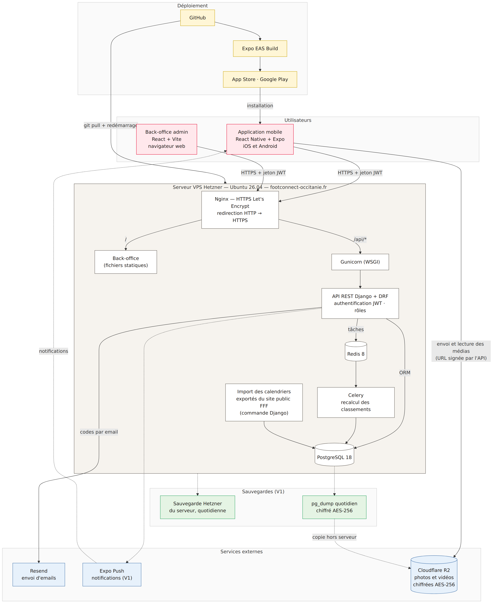

**Lecture du schéma :**

- **Frontends :** l'application mobile (utilisateurs) et le back-office web (administrateurs) appellent la même API, toujours en HTTPS, avec un jeton JWT dans l'en-tête `Authorization`.
- **Serveur :** Nginx reçoit toutes les requêtes. Il sert les pages du back-office et transmet les requêtes `/api/*` à Gunicorn, qui exécute Django.
- **Authentification :** Django vérifie le jeton JWT à chaque requête, puis contrôle les droits (utilisateur ou administrateur).
- **Base de données :** Django lit et écrit dans PostgreSQL uniquement via son ORM.
- **Tâches de fond :** Django place les recalculs de classement dans Redis, et Celery les exécute.
- **Stockage :** les photos et vidéos ne passent pas par le serveur. L'API donne au téléphone une URL d'envoi signée, et le téléphone envoie le fichier directement sur Cloudflare R2.
- **Services externes :** Resend envoie les emails ; Expo Push enverra les notifications (V1).
- **Sauvegardes (V1) :** sauvegarde quotidienne du serveur par Hetzner, et copie quotidienne de la base, chiffrée en AES-256, sur Cloudflare R2, donc hors du serveur.
- **Déploiement :** le serveur se met à jour depuis GitHub (`git pull`, migrations, redémarrage de Gunicorn) ; l'appli mobile est compilée par Expo EAS puis publiée sur les stores.

### 3.3 Flux requête-réponse : publier une photo de match

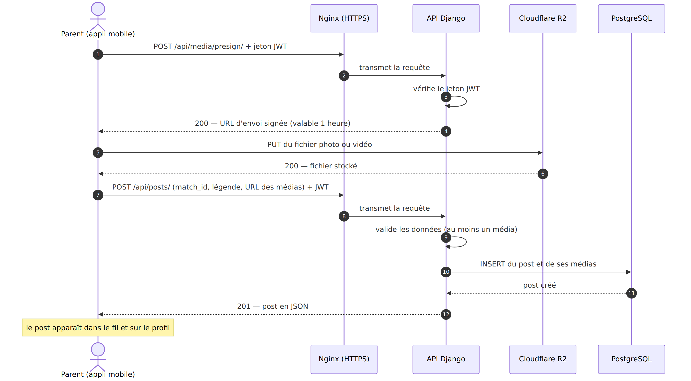

1. L'appli demande une URL d'envoi à l'API (`POST /api/media/presign/`), avec le jeton JWT.
2. L'API vérifie le jeton et renvoie une URL signée, valable 1 heure, qui autorise l'envoi d'un seul fichier.
3. L'appli envoie la photo ou la vidéo directement sur Cloudflare R2.
4. L'appli crée le post (`POST /api/posts/`) avec le match choisi (ou les deux équipes saisies à la main), la légende et l'adresse des médias.
5. L'API valide les données, enregistre le post et ses médias dans PostgreSQL et renvoie le post créé (code 201).
6. Le post apparaît dans le fil d'actualité et sur le profil de l'utilisateur.

## 4. Diagrammes UML et système

Les trois diagrammes ci-dessous sont tirés du code réel de l'application. Ils sont cohérents avec les user stories (section 1), l'architecture (section 3), la base de données et la documentation de l'API.

### 4.1 Diagramme de cas d'utilisation

**Ce qu'il montre :** qui fait quoi dans l'application. Il prouve que chaque type d'utilisateur a un rôle clair, que les fonctions d'administration sont séparées des fonctions grand public, et quels cas d'utilisation dépendent d'un service externe.

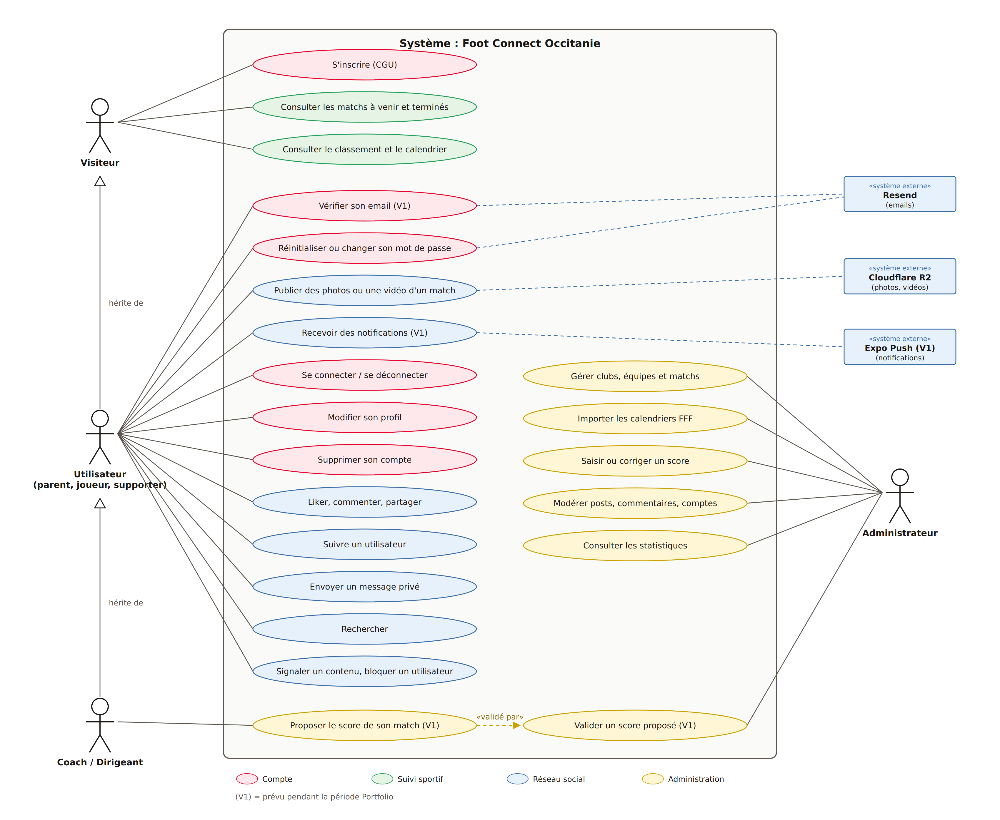

**Acteurs :**

- **Visiteur** (sans compte) : s'inscrit, consulte les matchs, le classement et le calendrier.
- **Utilisateur** (parent, joueur, supporter) : hérite des cas du visiteur ; gère son compte, publie, réagit, suit d'autres utilisateurs, envoie des messages, recherche, signale et bloque.
- **Coach / Dirigeant** : hérite des cas de l'utilisateur ; peut en plus proposer le score de son match (V1).
- **Administrateur** : gère les données sportives, saisit les scores, modère, consulte les statistiques et valide les scores proposés (V1).
- **Systèmes externes** : Resend (emails de vérification et de réinitialisation), Cloudflare R2 (stockage des médias publiés), Expo Push (notifications, V1).

Chaque cas d'utilisation correspond à une user story : par exemple « Publier des photos ou une vidéo d'un match » correspond à l'US8, « Saisir ou corriger un score » à l'US16.

### 4.2 Diagramme de séquence : saisie d'un score et mise à jour du classement

**Ce qu'il montre :** la fonctionnalité la plus critique pour la confiance des utilisateurs, car un classement faux décrédibilise l'appli. Il prouve que seul un administrateur peut saisir un score, que le match est verrouillé pour qu'un import ne l'écrase pas, et que le recalcul du classement se fait en arrière-plan (Celery) sans ralentir l'administrateur. Le flux de publication d'un post est détaillé en section 3.3.

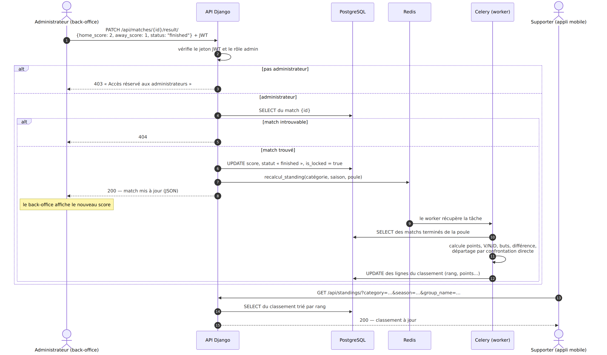

1. L'administrateur saisit le score dans le back-office, qui envoie `PATCH /api/matches/{id}/result/` avec le jeton JWT.
2. L'API vérifie le jeton et le rôle : un non-administrateur reçoit une erreur 403.
3. L'API cherche le match : s'il n'existe pas, elle renvoie une erreur 404.
4. L'API enregistre le score, passe le match en « terminé » et le verrouille (`is_locked = true`).
5. L'API place la tâche `recalcul_standing` dans la file Redis et répond immédiatement 200 au back-office.
6. Le worker Celery récupère la tâche, relit tous les matchs terminés de la poule, recalcule points, victoires, nuls, défaites et buts, départage les égalités par la confrontation directe, puis met à jour le classement.
7. Quand un supporter ouvre l'onglet Classement, l'appli appelle `GET /api/standings/` et reçoit le classement à jour, trié par rang.

### 4.3 Diagramme de classes

**Ce qu'il montre :** le back-end est écrit en programmation orientée objet. Chaque table est une classe Python qui hérite de `models.Model` de Django, et `User` hérite de `AbstractUser`. Le diagramme montre les principales classes, leurs attributs, quelques méthodes et leurs relations avec les cardinalités. Il prouve que les données sont reliées de façon cohérente : un club possède des équipes, une équipe joue des matchs et a une ligne de classement, un match est illustré par des posts, un post contient des médias et reçoit des commentaires et des likes.

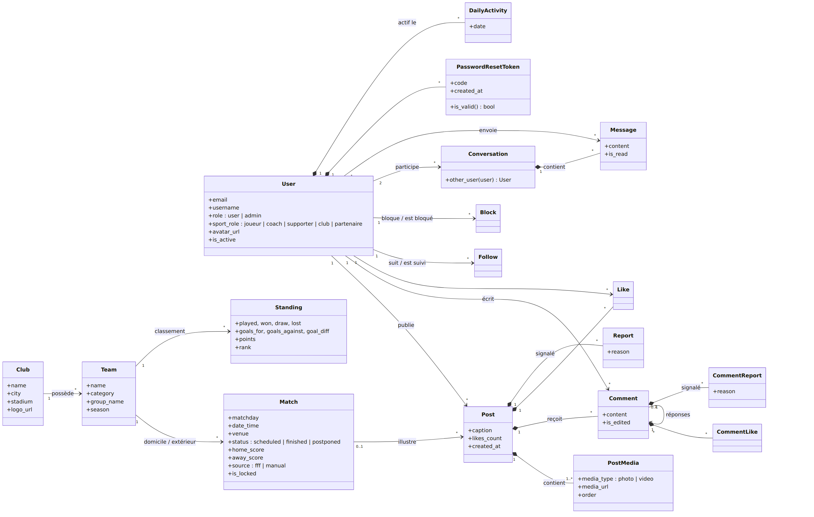

**Points clés :**

- **Composition** (losange plein) : un `PostMedia`, un `Comment` ou un `Like` n'existe pas sans son `Post` ; supprimer un post supprime ses médias, commentaires, likes et signalements.
- **Match facultatif sur un post** (`0..1`) : un post peut être relié à un match de la base, ou à deux équipes saisies à la main (voir section 0).
- **Commentaires en arbre** : un commentaire peut répondre à un autre commentaire (relation de `Comment` vers lui-même).
- **Méthodes métier** : `PasswordResetToken.is_valid()` vérifie qu'un code a moins de 15 minutes ; `Conversation.other_user(user)` renvoie l'autre participant d'une conversation.
- **Classes regroupées par application Django** : `users` (User, PasswordResetToken, DailyActivity), `clubs`, `teams`, `matches`, `standings`, `posts` (Post, PostMedia), `interactions` (Like, Comment, CommentLike, Follow, Block, Report, CommentReport) et `messaging` (Conversation, Message).

## 5. Modèle de base de données

La base est une base **PostgreSQL 18** de **19 tables métier** (hors tables internes de Django). Elle est entièrement décrite par les modèles Django et créée par des migrations versionnées dans Git. Le schéma ci-dessous est tiré du code réel.

### 5.1 ERD — vue d'ensemble

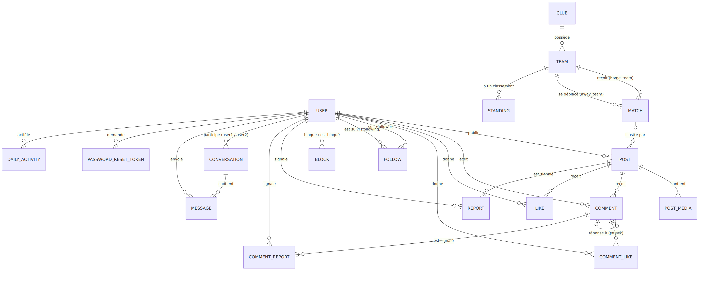

Cette vue montre uniquement les tables et leurs relations. Les colonnes de chaque table sont détaillées dans les trois zooms ci-dessous ; le schéma complet en un seul bloc est dans le dépôt (`docs/portfolio/diagrammes/erd.png`).

Pour la lisibilité, le même schéma est découpé en trois zooms. Une table réduite à son `id` est détaillée dans un autre zoom.

**Zoom 1 — Données sportives**

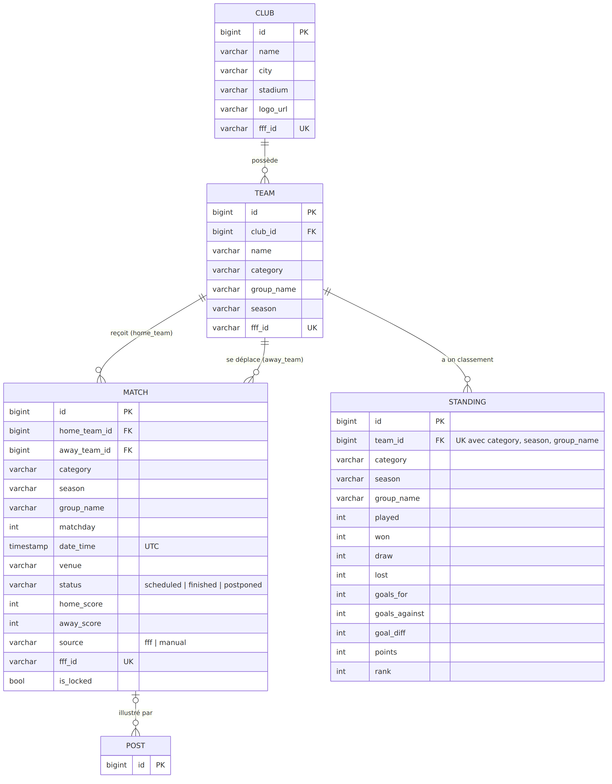

**Zoom 2 — Publications et interactions**

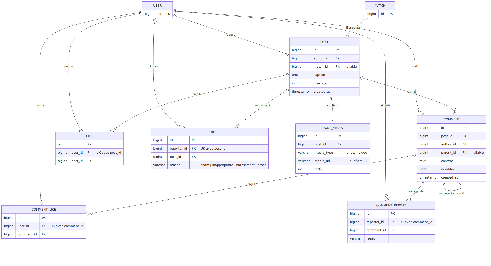

**Zoom 3 — Utilisateurs, abonnements et messagerie**

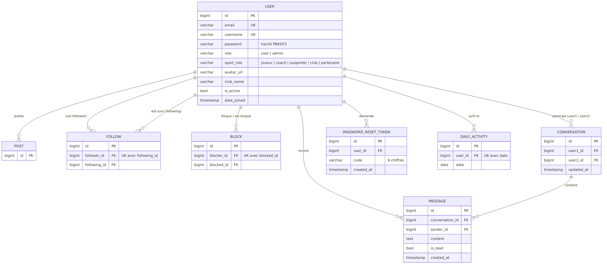

**Légende :** PK = clé primaire, FK = clé étrangère, UK = valeur unique. `||--o{` se lit « un à zéro ou plusieurs », `||--|{` « un à un ou plusieurs », `|o--o{` « zéro ou un à zéro ou plusieurs ».

### 5.2 Tables

| Table | Rôle | Clé primaire | Clés étrangères |
| --- | --- | --- | --- |
| `users_user` | Comptes : email (identifiant de connexion), nom d'utilisateur, mot de passe haché, rôle (`user` ou `admin`), rôle sportif, avatar | `id` | — |
| `users_passwordresettoken` | Codes de réinitialisation du mot de passe, valables 15 minutes | `id` | `user_id` |
| `users_dailyactivity` | Une ligne par utilisateur et par jour d'utilisation (statistiques) | `id` | `user_id` |
| `clubs_club` | Clubs : nom, ville, adresse du stade, logo | `id` | — |
| `teams_team` | Équipes d'un club pour une catégorie, une poule et une saison | `id` | `club_id` |
| `matches_match` | Matchs : date, lieu, statut, score, source (FFF ou manuel), verrouillage | `id` | `home_team_id`, `away_team_id` |
| `standings_standing` | Une ligne de classement par équipe, catégorie, saison et poule | `id` | `team_id` |
| `scraper_synclog` | Historique des synchronisations de données (table isolée, sans relation) | `id` | — |
| `posts_post` | Publications : légende, nombre de likes, date | `id` | `author_id`, `match_id` (facultatif) |
| `posts_postmedia` | Photos et vidéos d'un post (adresse sur Cloudflare R2, ordre dans le carrousel) | `id` | `post_id` |
| `interactions_comment` | Commentaires et réponses à un commentaire | `id` | `post_id`, `author_id`, `parent_id` (facultatif) |
| `interactions_like` | Likes sur les posts | `id` | `user_id`, `post_id` |
| `interactions_commentlike` | Likes sur les commentaires | `id` | `user_id`, `comment_id` |
| `interactions_follow` | Abonnements entre utilisateurs | `id` | `follower_id`, `following_id` |
| `interactions_block` | Blocages entre utilisateurs | `id` | `blocker_id`, `blocked_id` |
| `interactions_report` | Signalements de posts, avec un motif | `id` | `reporter_id`, `post_id` |
| `interactions_commentreport` | Signalements de commentaires, avec un motif | `id` | `reporter_id`, `comment_id` |
| `messaging_conversation` | Conversation privée entre deux utilisateurs | `id` | `user1_id`, `user2_id` |
| `messaging_message` | Messages d'une conversation, avec statut lu / non lu | `id` | `conversation_id`, `sender_id` |

Toutes les clés primaires sont des entiers 64 bits auto-incrémentés (`bigint`). Chaque clé étrangère est indexée automatiquement par Django.

### 5.3 Relations et cardinalités

| Relation | Cardinalité | Si le parent est supprimé |
| --- | --- | --- |
| Club → Équipes | 1 club possède 0 à N équipes | Ses équipes sont supprimées |
| Équipe → Matchs | 1 équipe joue 0 à N matchs à domicile et 0 à N à l'extérieur ; 1 match a exactement 2 équipes | Ses matchs sont supprimés |
| Équipe → Classement | 1 équipe a 0 à N lignes de classement (une par catégorie, saison et poule) | Ses lignes sont supprimées |
| Match → Posts | 1 match est illustré par 0 à N posts ; 1 post est relié à 0 ou 1 match | Les posts sont **conservés**, sans match (`SET NULL`) |
| Utilisateur → Posts | 1 utilisateur publie 0 à N posts | Ses posts sont supprimés |
| Post → Médias | 1 post contient 1 à N médias | Ses médias sont supprimés |
| Post → Commentaires, likes, signalements | 1 post reçoit 0 à N de chaque | Tout est supprimé |
| Commentaire → Réponses | 1 commentaire a 0 à N réponses ; 1 réponse a 1 commentaire parent | Les réponses sont supprimées |
| Utilisateur ↔ Utilisateur (abonnement, blocage) | Plusieurs à plusieurs, via les tables `follow` et `block` | Les liens sont supprimés |
| Utilisateur ↔ Conversation | Chaque conversation relie exactement 2 utilisateurs ; 1 utilisateur a 0 à N conversations | Ses conversations et messages sont supprimés |
| Conversation → Messages | 1 conversation contient 0 à N messages | Ses messages sont supprimés |

### 5.4 Choix importants

- **Base relationnelle PostgreSQL :** les données sont très liées (club → équipe → match → post → commentaire). Les clés étrangères et les contraintes garantissent la cohérence, ce qu'une base NoSQL ne ferait pas d'elle-même.
- **Suppression en cascade pour le RGPD :** supprimer un compte supprime automatiquement toutes ses données (posts, médias, commentaires, likes, abonnements, messages). Aucune donnée personnelle orpheline ne reste en base.
- **Un post survit à la suppression de son match (`SET NULL`) :** si un match importé par erreur est supprimé, les photos des utilisateurs ne sont pas perdues.
- **Unicité garantie par la base :** un utilisateur ne peut liker un post qu'une fois, suivre ou bloquer quelqu'un qu'une fois, et signaler un contenu qu'une fois ; une équipe n'a qu'une ligne de classement par poule. Même si deux requêtes arrivent en même temps, la base refuse le doublon.
- **Classement stocké, pas recalculé à chaque lecture :** la table `standings_standing` est mise à jour par Celery à chaque nouveau score. Afficher un classement est une simple lecture triée par rang, rapide même avec des milliers de matchs.
- **Données dénormalisées pour la vitesse :** `likes_count` sur le post évite de compter les likes à chaque affichage du fil ; `category`, `season` et `group_name` sont copiés sur le match pour filtrer la page Matchs sans jointure.
- **Protection des corrections manuelles :** `is_locked` empêche un import de données d'écraser un score corrigé par l'administrateur ; `source` indique si le match vient de la FFF ou a été créé à la main.
- **Médias hors de la base :** la base ne stocke que l'adresse des fichiers ; les photos et vidéos sont sur Cloudflare R2. La base reste légère et facile à sauvegarder.
- **Dates en UTC :** toutes les dates sont stockées en UTC et converties à l'heure de Paris à l'affichage, ce qui gère correctement le passage à l'heure d'été et d'hiver.
- **Identifiants entiers plutôt qu'UUID :** plus simples et plus compacts. Ils ne posent pas de risque de sécurité, car chaque requête vérifie les droits de l'utilisateur sur l'objet demandé.

### 5.5 Améliorations prévues (V1)

Certaines règles sont aujourd'hui vérifiées dans le code de l'API, mais pas encore par la base elle-même. Elles seront ajoutées en contraintes PostgreSQL :

- une équipe ne peut pas jouer contre elle-même (`home_team_id` différent de `away_team_id`) ;
- un utilisateur ne peut pas se suivre ni se bloquer lui-même (déjà refusé par l'API) ;
- une seule conversation par paire d'utilisateurs, quel que soit l'ordre (déjà géré par l'API) ;
- un post doit avoir un match ou deux équipes saisies (voir section 0) ;
- un index sur `matches_match (category, season, group_name, date_time)` pour accélérer la page Matchs, la requête la plus fréquente.

## 6. Documentation des API

Cette section permet à un autre développeur d'utiliser l'API sans lire le code. Tous les exemples de réponses ont été **capturés en appelant réellement l'API** sur une base de test (seules les valeurs longues sont raccourcies par « … »).

### 6.1 Conventions générales

| Élément | Règle |
| --- | --- |
| URL de base | `https://footconnect-occitanie.fr/api` |
| Format | JSON en entrée et en sortie (`Content-Type: application/json`) |
| Barre oblique finale | Obligatoire : `/api/posts/` et non `/api/posts` |
| Authentification | En-tête `Authorization: Bearer <jeton d'accès>` ; jeton d'accès valable 8 h, jeton de rafraîchissement valable 7 jours |
| Niveaux d'accès | **Public** (sans jeton), **Connecté** (jeton valide), **Admin** (jeton d'un compte `role = admin`) |
| Dates | Format ISO 8601 en UTC, par exemple `2026-10-24T09:00:00Z` (= 11h00 à Paris) |
| Listes | Renvoyées en entier, sans pagination (pagination prévue en V1) |

**Codes de réponse utilisés :**

| Code | Signification |
| --- | --- |
| 200 OK | Lecture ou action réussie |
| 201 Created | Ressource créée |
| 202 Accepted | Tâche lancée en arrière-plan |
| 204 No Content | Suppression réussie, réponse vide |
| 400 Bad Request | Données manquantes ou invalides |
| 401 Unauthorized | Jeton absent, invalide ou expiré ; identifiants faux |
| 403 Forbidden | Connecté mais pas autorisé (pas admin, pas l'auteur, pas participant) |
| 404 Not Found | Ressource introuvable |
| 405 Method Not Allowed | Méthode non prévue sur cette URL |
| 500 Internal Server Error | Erreur du serveur |

**Format des erreurs :** une erreur générale renvoie un message dans `detail` ; une erreur de validation renvoie la liste des problèmes pour chaque champ.

```json
{ "detail": "Accès réservé aux administrateurs." }
```

```json
{
  "email": ["user with this email already exists."],
  "password": ["This password is too short. It must contain at least 8 characters."]
}
```

### 6.2 Liste des endpoints

| Méthode | URL | Rôle | Accès |
| --- | --- | --- | --- |
| POST | `/auth/register/` | Créer un compte | Public |
| POST | `/auth/login/` | Se connecter, obtenir les jetons | Public |
| POST | `/auth/refresh/` | Obtenir un nouveau jeton d'accès | Public (jeton de rafraîchissement) |
| GET | `/auth/me/` | Lire son profil | Connecté |
| PATCH | `/auth/me/` | Modifier son nom, rôle sportif, avatar, club | Connecté |
| DELETE | `/auth/me/` | Supprimer son compte et toutes ses données | Connecté |
| POST | `/auth/forgot-password/` | Recevoir un code de réinitialisation par email | Public |
| POST | `/auth/reset-password/` | Changer son mot de passe avec le code | Public |
| GET | `/users/{id}/` | Profil d'un utilisateur | Connecté |
| GET | `/users/{id}/followers/` | Abonnés d'un utilisateur | Connecté |
| GET | `/users/{id}/following/` | Abonnements d'un utilisateur | Connecté |
| POST | `/users/{id}/follow/` | Suivre / ne plus suivre (bascule) | Connecté |
| POST | `/users/{id}/block/` | Bloquer / débloquer (bascule) | Connecté |
| GET | `/matches/` | Liste des matchs, filtrable | Public |
| GET | `/matches/{id}/` | Détail d'un match | Public |
| GET | `/matches/filters/` | Catégories disponibles pour une saison | Public |
| GET | `/matches/groups/` | Poules d'une catégorie | Public |
| POST | `/matches/` | Créer un match | Admin |
| PATCH / PUT | `/matches/{id}/` | Modifier un match (date, lieu, poule…) | Admin |
| DELETE | `/matches/{id}/` | Supprimer un match | Admin |
| PATCH | `/matches/{id}/result/` | Saisir un score (verrouille le match, recalcule le classement) | Admin |
| PATCH | `/matches/{id}/unlock/` | Déverrouiller un match | Admin |
| POST | `/matches/fill_venues/` | Remplir les lieux manquants avec le stade du club | Admin |
| GET | `/standings/` | Classement d'une poule | Public |
| GET | `/clubs/`, `/clubs/{id}/` | Liste et détail des clubs | Connecté |
| POST, PUT, PATCH, DELETE | `/clubs/`, `/clubs/{id}/` | Créer, modifier, supprimer un club | Admin |
| GET | `/teams/`, `/teams/{id}/` | Liste (filtrable) et détail des équipes | Connecté |
| GET | `/teams/categories/`, `/teams/groups/` | Catégories et poules des équipes | Connecté |
| POST, PUT, PATCH, DELETE | `/teams/`, `/teams/{id}/` | Créer, modifier, supprimer une équipe | Admin |
| POST | `/teams/{id}/set_home_venue/` | Appliquer une adresse aux matchs à domicile de l'équipe | Admin |
| POST | `/media/presign/` | Obtenir une URL d'envoi vers Cloudflare R2 | Connecté |
| GET | `/posts/` | Liste des posts (`?author=id` pour un profil) | Public |
| GET | `/posts/{id}/` | Détail d'un post | Public |
| POST | `/posts/` | Publier un post | Connecté |
| DELETE | `/posts/{id}/` | Supprimer un post | Auteur ou admin |
| GET | `/feed/` | Fil d'actualité (sans les utilisateurs bloqués) | Connecté |
| GET | `/search/?q=` | Rechercher utilisateurs et posts | Connecté |
| POST | `/posts/{id}/like/` | Liker / retirer son like (bascule) | Connecté |
| POST | `/posts/{id}/report/` | Signaler un post | Connecté |
| GET | `/posts/{id}/comments/` | Commentaires d'un post, avec leurs réponses | Connecté |
| POST | `/posts/{id}/comments/` | Commenter (ou répondre avec `parent_id`) | Connecté |
| PATCH | `/posts/{id}/comments/{cid}/` | Modifier un commentaire | Auteur |
| DELETE | `/posts/{id}/comments/{cid}/` | Supprimer un commentaire | Auteur ou admin |
| POST | `/comments/{id}/like/` | Liker un commentaire (bascule) | Connecté |
| POST | `/comments/{id}/report/` | Signaler un commentaire | Connecté |
| GET | `/conversations/` | Mes conversations | Connecté |
| POST | `/conversations/` | Ouvrir (ou retrouver) une conversation | Connecté |
| GET | `/conversations/{id}/messages/` | Messages d'une conversation | Participant |
| POST | `/conversations/{id}/messages/` | Envoyer un message | Participant |
| PATCH | `/conversations/{id}/read/` | Marquer les messages reçus comme lus | Participant |
| GET | `/reports/` | Tous les signalements | Admin |
| DELETE | `/reports/?type=post&id=` | Classer un signalement | Admin |
| GET | `/auth/admin/users/` | Liste des utilisateurs | Admin |
| PATCH | `/auth/admin/users/{id}/` | Bannir / réactiver (`action`: `ban` ou `unban`) | Admin |
| DELETE | `/auth/admin/users/{id}/` | Supprimer un utilisateur | Admin |
| GET | `/admin/stats/` | Statistiques d'utilisation | Admin |
| POST, GET | `/scraper/sync`, `/scraper/status`, `/scraper/logs` | Ancienne synchronisation automatique FFF (inactive depuis le refus de la FFF) | Admin |

### 6.3 Détail des endpoints principaux

#### Créer un compte — `POST /api/auth/register/`

**Accès :** public. **Corps :** `username`, `email`, `password` (8 caractères minimum, pas trop courant ni trop proche du nom).

```json
{ "username": "sophie_m", "email": "sophie@example.com", "password": "Football2026!" }
```

**201 Created**

```json
{
  "id": 1, "username": "sophie_m", "email": "sophie@example.com",
  "role": "user", "sport_role": "supporter", "avatar_url": null, "club_name": null
}
```

**400 Bad Request** (nom ou email déjà pris, mot de passe trop faible)

```json
{
  "username": ["A user with that username already exists."],
  "email": ["user with this email already exists."],
  "password": ["This password is too short. It must contain at least 8 characters.", "This password is too common."]
}
```

#### Se connecter — `POST /api/auth/login/`

**Accès :** public. **Corps :** `email`, `password`.

**200 OK**

```json
{ "access": "eyJhbGciOiJIUzI1NiIs…", "refresh": "eyJhbGciOiJIUzI1NiIs…" }
```

**401 Unauthorized** — le message ne précise pas si c'est l'email ou le mot de passe qui est faux :

```json
{ "detail": "Email ou mot de passe incorrect." }
```

#### Renouveler le jeton — `POST /api/auth/refresh/`

**Corps :** `{ "refresh": "eyJhbGciOi…" }`. **200 OK :** `{ "access": "eyJhbGciOi…" }`. **401** si le jeton de rafraîchissement est expiré.

#### Mon profil — `GET`, `PATCH`, `DELETE /api/auth/me/`

**Accès :** connecté. `PATCH` accepte `username`, `sport_role` (`joueur`, `coach`, `supporter`, `club`, `partenaire`), `avatar_url`, `club_name`. `DELETE` supprime le compte et toutes ses données et renvoie **204 No Content**.

**200 OK** (GET et PATCH)

```json
{
  "id": 1, "username": "sophie_m", "email": "sophie@example.com", "role": "user",
  "sport_role": "joueur", "avatar_url": null, "club_name": null,
  "followers_count": 0, "following_count": 0
}
```

**401 Unauthorized** sans jeton :

```json
{ "detail": "Authentication credentials were not provided." }
```

#### Mot de passe oublié — `POST /api/auth/forgot-password/` puis `POST /api/auth/reset-password/`

1. `forgot-password` reçoit `{ "email": "…" }` et envoie un code à 6 chiffres par email (via Resend). Il répond toujours **200** avec le même message, que l'email existe ou non : `{ "detail": "Si cet email est enregistré, un code a été envoyé." }`.
2. `reset-password` reçoit `{ "email": "…", "code": "482913", "new_password": "…" }`. **200 :** `{ "detail": "Mot de passe mis à jour avec succès." }`. **400 :** `{ "detail": "Code invalide." }` ou `{ "detail": "Code expiré. Demande un nouveau code." }` (code valable 15 minutes).

#### Liste des matchs — `GET /api/matches/`

**Accès :** public. **Paramètres (facultatifs) :** `category` (ex. `U18`), `season` (ex. `2026/2027`), `group_name` (ex. `Poule B`), `status` (`scheduled`, `finished`, `postponed`). Résultats triés par date.

```
GET /api/matches/?category=U18&season=2026/2027&group_name=Poule B&status=scheduled
```

**200 OK** (un élément, équipes raccourcies)

```json
[
  {
    "id": 1,
    "home_team": { "id": 1, "name": "Toulouse FC", "category": "U18", "logo_url": null, "home_venue": "Stadium, 31400 Toulouse", "club": { "id": 1, "name": "Toulouse FC", "city": "Toulouse" } },
    "away_team": { "id": 2, "name": "Blagnac FC", "category": "U18", "logo_url": null, "home_venue": null, "club": { "id": 2, "name": "Blagnac FC", "city": "Blagnac" } },
    "category": "U18", "season": "2026/2027", "group_name": "Poule B", "matchday": 3,
    "date_time": "2026-10-24T09:00:00Z", "venue": "Stadium, 31400 Toulouse",
    "status": "scheduled", "home_score": null, "away_score": null,
    "source": "fff", "fff_id": null, "is_locked": false
  }
]
```

#### Saisir un score — `PATCH /api/matches/{id}/result/`

**Accès :** admin. **Corps :** `home_score`, `away_score`, `status`. Effet : le match passe en `finished`, `is_locked` passe à `true`, et le classement de la poule est recalculé en arrière-plan.

```json
{ "home_score": 2, "away_score": 1, "status": "finished" }
```

**200 OK :** le match complet mis à jour (même format que la liste). **403 Forbidden :** `{ "detail": "Accès réservé aux administrateurs." }`. **404 Not Found** si le match n'existe pas.

#### Classement — `GET /api/standings/`

**Accès :** public. **Paramètres :** `category`, `season`, `group_name`. Trié par rang.

**200 OK** (premier élément)

```json
[
  {
    "id": 1, "team": 1, "team_name": "Toulouse FC", "category": "U18", "season": "2026/2027",
    "group_name": "Poule B", "played": 1, "won": 1, "draw": 0, "lost": 0,
    "goals_for": 2, "goals_against": 1, "goal_diff": 1, "points": 3, "rank": 1
  }
]
```

#### Obtenir une URL d'envoi de média — `POST /api/media/presign/`

**Accès :** connecté. **Corps :** `file_name`, `content_type`. L'appli envoie ensuite le fichier avec `PUT upload_url` (en-tête `Content-Type` identique), puis utilise `public_url` dans le post. L'URL d'envoi est valable 1 heure.

```json
{ "file_name": "photo.jpg", "content_type": "image/jpeg" }
```

**200 OK**

```json
{
  "upload_url": "https://<compte>.r2.cloudflarestorage.com/foot-connect-media/uploads/690ea3fa-….jpg?X-Amz-Algorithm=AWS4-HMAC-SHA256&X-Amz-Expires=3600&X-Amz-Signature=…",
  "public_url": "https://pub-0edabdb62a3641eb961617ef694ad950.r2.dev/uploads/690ea3fa-….jpg"
}
```

#### Publier un post — `POST /api/posts/`

**Accès :** connecté. **Corps :** `match_id` (facultatif aujourd'hui, obligatoire en V1), `caption`, `medias` (au moins un élément : `media_type` = `photo` ou `video`, `media_url` = l'adresse `public_url`).

```json
{
  "match_id": 1,
  "caption": "Belle victoire des U18 !",
  "medias": [ { "media_type": "photo", "media_url": "https://pub-….r2.dev/uploads/3f2a.jpg" } ]
}
```

**201 Created**

```json
{
  "id": 1, "author_id": 1, "author_username": "sophie_m", "author_avatar_url": null,
  "match_info": {
    "id": 1, "home_team": "Toulouse FC", "away_team": "Blagnac FC",
    "date_time": "2026-10-24T09:00:00Z", "category": "U18", "group_name": "Poule B",
    "status": "scheduled", "home_score": null, "away_score": null
  },
  "caption": "Belle victoire des U18 !", "likes_count": 0, "comments_count": 0, "is_liked": false,
  "medias": [ { "id": 1, "media_type": "photo", "media_url": "https://pub-….r2.dev/uploads/3f2a.jpg", "order": 0 } ],
  "created_at": "2026-11-26T14:52:47.178020Z"
}
```

**400 Bad Request :** `{ "detail": "Au moins un média est requis." }`

`GET /api/feed/` renvoie une liste de posts dans ce même format, du plus récent au plus ancien, sans les posts des utilisateurs bloqués.

#### Liker un post — `POST /api/posts/{id}/like/`

**Accès :** connecté, sans corps. Un premier appel ajoute le like, un second le retire. **200 OK :** `{ "liked": true, "likes_count": 1 }`. **404** si le post n'existe pas.

#### Commenter — `POST /api/posts/{id}/comments/`

**Accès :** connecté. **Corps :** `content` (non vide), `parent_id` facultatif pour répondre à un commentaire. `DELETE` sur `/posts/{id}/comments/{cid}/` renvoie **204** (auteur ou admin, sinon **403**). L'API accepte aussi `PATCH` pour modifier un commentaire (auteur uniquement, sinon **403**), mais l'appli ne l'utilise pas.

**201 Created**

```json
{
  "id": 1, "author_id": 1, "author_username": "sophie_m", "author_avatar_url": null,
  "content": "Super match !", "is_edited": false, "parent_id": null, "replies": [],
  "created_at": "2026-11-26T14:52:47.194194Z", "updated_at": "2026-11-26T14:52:47.194205Z",
  "likes_count": 0, "is_liked": false
}
```

**400 Bad Request :** `{ "content": ["This field may not be blank."] }`

#### Suivre un utilisateur — `POST /api/users/{id}/follow/`

**Accès :** connecté, sans corps. Bascule suivre / ne plus suivre. **200 OK :** `{ "following": true }`. **400 :** `{ "detail": "Vous ne pouvez pas vous suivre vous-même." }`. Bloquer (`/users/{id}/block/`) fonctionne de la même façon (`{ "blocked": true }`) et supprime les abonnements dans les deux sens.

#### Signaler un post — `POST /api/posts/{id}/report/`

**Accès :** connecté. **Corps :** `reason` = `spam`, `inappropriate`, `harassment` ou `other`. **200 OK :** `{ "detail": "Contenu signalé. Notre équipe va examiner ce signalement." }`. Un second signalement du même post par la même personne est ignoré.

#### Messagerie — `/api/conversations/…`

1. `POST /conversations/` avec `{ "target_user_id": 3 }` ouvre la conversation, ou renvoie celle qui existe déjà. **201 :** `{ "id": 1, "other_username": "lucas_t", "last_message": null, "unread_count": 0, "updated_at": "…" }`.
2. `POST /conversations/1/messages/` avec `{ "content": "Salut, prêt pour le match ?" }`. **201 :** `{ "id": 1, "sender_username": "sophie_m", "content": "Salut, prêt pour le match ?", "is_read": false, "created_at": "…" }`.
3. `GET /conversations/1/messages/` liste les messages du plus ancien au plus récent ; `PATCH /conversations/1/read/` marque comme lus les messages reçus et renvoie leur nombre, par exemple `{ "marked_read": 0 }` quand il n'y en a aucun.

Un utilisateur qui n'est pas participant reçoit **403** ; une conversation inexistante renvoie **404**.

#### Signalements (admin) — `GET /api/reports/`

**200 OK**

```json
{
  "post_reports": [
    { "id": 1, "type": "post", "reason": "spam", "reporter": "sophie_m", "created_at": "…",
      "post_id": 1, "post_author": "sophie_m", "post_caption": "Belle victoire des U18 !" }
  ],
  "comment_reports": [
    { "id": 1, "type": "comment", "reason": "inappropriate", "reporter": "sophie_m", "created_at": "…",
      "comment_id": 1, "comment_author": "sophie_m", "comment_content": "Super match, bravo !", "post_id": 1 }
  ]
}
```

`DELETE /api/reports/?type=post&id=1` classe le signalement : `{ "detail": "Signalement supprimé." }`.

#### Statistiques (admin) — `GET /api/admin/stats/`

**200 OK** (extrait)

```json
{
  "kpis": { "users_total": 2, "new_users_7d": 2, "active_today": 1, "active_7d": 1, "active_30d": 1, "posts_total": 1 },
  "retention": { "cohort_size": 0, "returned": 0 },
  "tracking_since": "2026-11-26",
  "daily": [ { "date": "2026-10-28", "active": 0, "signups": 0, "posts": 0, "likes": 0, "comments": 0, "messages": 0 }, "…" ],
  "roles": [ { "role": "Joueur", "count": 1 }, { "role": "Supporter", "count": 1 } ],
  "top_posts": [ "…" ], "top_teams": [ { "team": "Toulouse FC", "posts": 1 }, { "team": "Blagnac FC", "posts": 1 } ]
}
```

### 6.4 API et services externes

| Service | Utilisation | Appel | Authentification | Données échangées |
| --- | --- | --- | --- | --- |
| Cloudflare R2 | Stockage des photos et vidéos | L'API génère une URL signée (bibliothèque `boto3`, API compatible S3) ; l'appli fait un `PUT` direct du fichier ; les médias sont lus via l'URL publique du bucket | Clés d'accès R2 dans le `.env` du serveur ; le téléphone ne reçoit qu'une URL signée valable 1 heure | Fichier (image ou vidéo) ; nom de fichier aléatoire (UUID) |
| Resend | Envoi des emails (codes de réinitialisation ; vérification du compte en V1) | `POST https://api.resend.com/emails` depuis le serveur, délai maximal 10 s | Clé API dans le `.env` (`Authorization: Bearer`) | Adresse email du destinataire, sujet, contenu HTML avec le code |
| Expo Push (V1) | Notifications sur iOS et Android | `POST https://exp.host/--/api/v2/push/send` depuis le serveur | Jeton de notification de chaque téléphone, enregistré à la connexion | Jeton du téléphone, titre, texte, données de navigation |
| FFF | Source des calendriers et résultats officiels | Aucun appel automatique : la FFF a refusé l'accès à ses API. Les calendriers sont exportés depuis son site public puis importés avec `python manage.py import_calendar <fichier>` | — | Fichier texte : journée, date, équipes, score |

### 6.5 Défauts détectés pendant la documentation (à corriger en V1)

Documenter l'API en l'appelant réellement a révélé plusieurs points :

| Problème | Risque | Correction prévue |
| --- | --- | --- |
| Un utilisateur connecté peut modifier le commentaire d'un autre en appelant directement l'API (`PATCH`), vérifié par un test. L'appli ne propose pas cette action, mais l'API est accessible sans l'appli (Postman, curl) | Faille de contrôle d'accès (OWASP API1 : Broken Object Level Authorization) | **Corrigé** : l'API renvoie 403 si l'utilisateur n'est pas l'auteur ; test automatique ajouté |
| `GET /users/{id}/` renvoie l'adresse email de l'utilisateur consulté. L'appli ne l'affiche pas, mais elle circule dans la réponse et peut être lue en interceptant le trafic ou en appelant l'API directement | Fuite de données personnelles (RGPD) | **Corrigé** : l'email n'est plus renvoyé ; test automatique ajouté |
| `GET /feed/`, `/posts/` et `/matches/` renvoient toutes les lignes d'un coup | Lenteur et consommation de données quand le contenu grandit | Pagination par 20 (fil) et par 50 (matchs) |
| Formats d'erreur hétérogènes (`detail` ou erreurs par champ, messages mélangeant français et anglais) | Messages moins clairs pour l'utilisateur | Format unique `{ "code": "…", "detail": "…" }` en français |
| `POST /media/presign/` accepte n'importe quel type de fichier, sans limite de taille | Envoi de fichiers non désirés sur le stockage | Liste blanche (JPEG, PNG, HEIC, MP4, MOV) et taille maximale |
| `POST /matches/` enregistre `source = fff` pour un match créé à la main | Information de traçabilité fausse | Forcer `source = manual` à la création par l'admin |
| Endpoints `/scraper/*` encore en ligne alors que la synchronisation FFF est abandonnée | Code mort | Les retirer |

Une documentation interactive générée automatiquement (OpenAPI avec `drf-spectacular` et Swagger UI) est aussi prévue en V1, pour que cette documentation reste à jour à chaque modification du code.

## 7. Collaboration Git et stratégie de tests

### 7.1 Constat de départ

Le dépôt est hébergé sur GitHub (`malik31200/foot-connect-occitanie`) et compte 135 commits depuis le 15/04/2026.

- **Sprints 1 à 5 :** GitHub Flow respecté. Une branche par sprint (`feature/sprint-1-auth`, `feature/sprint-2a-scraper`, `feature/sprint-2b-frontend`, `feature/sprint-3-results-standings`, `feature/sprint-4-social`, `feature/sprint-5-deploy`), fusionnée dans `main` par une pull request (PR #1 à #6).
- **Depuis la mise en production (sprint 5) :** 103 commits ont été poussés directement sur `main`, souvent des correctifs urgents demandés par les utilisateurs ou par Apple. Aucun contrôle automatique ne tournait avant ces envois.

Pour la période Portfolio, je reviens à un GitHub Flow strict, protégé par des règles GitHub et une intégration continue. Les règles ci-dessous sont celles que j'applique désormais.

### 7.2 Stratégie de branches (GitHub Flow)

| Branche | Rôle | Règle |
| --- | --- | --- |
| `main` | Code en production (serveur et applis publiées) | Protégée : aucun push direct, fusion uniquement par pull request, tests verts obligatoires |
| `feature/<sujet>` | Nouvelle fonctionnalité | Créée depuis `main`, courte (2 à 3 jours de travail) |
| `fix/<sujet>` | Correction de bug | Créée depuis `main` |
| `hotfix/<sujet>` | Correction urgente en production | Créée depuis `main`, PR prioritaire, mêmes contrôles |
| `docs/<sujet>`, `test/<sujet>`, `chore/<sujet>` | Documentation, tests, maintenance | Créée depuis `main` |

**Convention de nommage :** en minuscules, mots séparés par des tirets, avec le numéro de l'issue GitHub quand il existe. Exemples : `feature/12-verification-email`, `fix/15-modification-commentaire`, `feature/18-notifications-push`, `test/20-tests-api-posts`.

Je n'utilise pas de branche `develop` : en développeur seul, avec des mises en production fréquentes, une branche intermédiaire ajouterait des fusions sans apporter de sécurité supplémentaire. La sécurité vient de la protection de `main` et de l'intégration continue.

### 7.3 Convention des messages de commit

Format **Conventional Commits**, déjà utilisé dans la majorité de l'historique (41 `fix`, 34 `feat`, 10 `chore`) :

```
<type>(<portée facultative>): <description à l'impératif, en français>
```

| Type | Usage | Exemple tiré du dépôt ou prévu |
| --- | --- | --- |
| `feat` | Nouvelle fonctionnalité | `feat(admin): page Stats (utilisateurs actifs par jour, inscrits, contenu, tops)` |
| `fix` | Correction de bug | `fix(admin): conversion heure de Paris <-> UTC dans le formulaire des matchs` |
| `test` | Ajout ou correction de tests | `test(posts): vérifier qu'un post sans média est refusé` |
| `docs` | Documentation | `docs: spécification technique du Portfolio` |
| `refactor` | Restructuration sans changement de comportement | `refactor(users): extraire l'envoi d'email dans un service` |
| `perf` | Performance | `perf(feed): paginer le fil d'actualité` |
| `chore` | Maintenance, versions, dépendances | `chore: bump version 1.0.8 (build 18)` |
| `ci` | Intégration continue | `ci: lancer les tests Django à chaque pull request` |

Règles : un commit = un changement cohérent ; référence à l'issue en fin de message (`Closes #12`) ; jamais de secret, de fichier `.env` ou de `node_modules` dans un commit (bloqués par le `.gitignore`).

### 7.4 Gestion des tâches et lien avec le code

- Chaque fonctionnalité V1 et chaque bug devient une **issue GitHub**, avec une étiquette (`feature`, `bug`, `security`, `test`, `docs`) et sa priorité MoSCoW.
- Les issues sont suivies dans un tableau **GitHub Projects** à 4 colonnes : À faire, En cours, En revue, Fait.
- La branche porte le numéro de l'issue, la pull request contient `Closes #<numéro>` : à la fusion, GitHub ferme l'issue et déplace la carte en « Fait ». On remonte ainsi d'une ligne de code à la user story qui l'a motivée.

### 7.5 Processus de pull request

1. Je crée une issue, puis une branche depuis `main` à jour (`git switch -c feature/12-verification-email`).
2. Je développe en petits commits, avec les tests correspondants.
3. Je lance les tests en local, puis je pousse la branche et j'ouvre une pull request vers `main`, avec le modèle ci-dessous.
4. L'intégration continue (GitHub Actions) lance automatiquement les tests du back-end et le build du back-office.
5. Je fais la revue de code avec la checklist de la section 7.6, en relisant le diff complet sur GitHub, le lendemain si possible pour avoir un regard neuf. Pour les changements sensibles (sécurité, base de données, authentification), je demande en plus une revue à mon mentor ou à un SWE.
6. Je corrige les remarques, puis je fusionne quand toutes les conditions sont réunies : tests verts, checklist validée, conflits résolus.
7. Je déploie : `git pull` sur le serveur, migrations, redémarrage ; nouveau build Expo si l'appli mobile est concernée.

**Modèle de description de pull request :**

```markdown
## Quoi
Résumé du changement en 2 ou 3 phrases.

## Pourquoi
Closes #12 — user story US2 (vérification email)

## Comment tester
1. …
2. …

## Checklist
- [ ] Tests ajoutés ou mis à jour, et verts
- [ ] Migrations incluses si le modèle change
- [ ] Aucun secret ni fichier .env
- [ ] Documentation mise à jour si besoin
```

### 7.6 Règles de revue de code

- Le code correspond à la user story et à ses critères d'acceptation.
- **Sécurité :** chaque nouvelle route vérifie l'authentification et le droit de l'utilisateur sur l'objet (auteur, participant, admin) ; aucune donnée personnelle inutile dans les réponses ; entrées validées par un serializer ; aucun secret dans le code.
- **Base de données :** migration fournie ; pas de requête dans une boucle quand un `select_related` ou `prefetch_related` suffit.
- **API :** codes HTTP cohérents (201, 400, 403, 404) et format d'erreur uniforme.
- **Mobile :** messages d'erreur compréhensibles en français, écrans testés sur un iPhone et un Android, clavier et petits écrans vérifiés.
- **Tests :** au moins un test pour le cas normal et un pour le cas d'erreur principal.
- **Lisibilité :** noms clairs, pas de code mort ni de `console.log` oubliés.

### 7.7 Stratégie de fusion

- **Squash and merge** pour les branches de fonctionnalité et de correction : chaque pull request devient un seul commit propre sur `main`, au format Conventional Commits, avec le numéro de la PR.
- La branche est supprimée après la fusion.
- **Protection de `main` sur GitHub :** pull request obligatoire, contrôles d'intégration continue obligatoires, branche à jour avec `main` avant fusion, interdiction du push forcé.

### 7.8 Résolution des conflits

1. Avant d'ouvrir ou de fusionner une PR, je mets la branche à jour : `git fetch origin` puis `git rebase origin/main`.
2. En cas de conflit, je le résous fichier par fichier dans VS Code, en gardant les deux intentions (jamais « tout garder de mon côté » sans relire).
3. **Migrations Django :** si deux branches créent une migration avec le même numéro, je ne modifie pas une migration déjà appliquée en production ; je génère une migration de fusion avec `python manage.py makemigrations --merge`.
4. Je relance les tests et je vérifie à la main la fonctionnalité touchée avant de pousser (`git push --force-with-lease`, uniquement sur ma propre branche).
5. Les migrations sont toujours créées en local et commitées, jamais générées sur le serveur de production (une migration créée sur le serveur, absente du dépôt, a déjà causé un écart en novembre 2026).

### 7.9 Stratégie de tests

| Niveau | Outil | Ce qui est testé | État |
| --- | --- | --- | --- |
| Tests d'API et d'intégration | Django `APITestCase` (Django REST Framework) | Chaque route critique appelée comme le ferait l'appli : codes HTTP, contenu JSON, droits d'accès, effets en base | **87 tests, tous verts** |
| Tests unitaires | Django `TestCase` | Calcul du classement (points, départage par confrontation directe), service d'import | Inclus dans les 87 |
| Intégration continue | GitHub Actions + PostgreSQL 16 | Tests du back-end, migrations manquantes, couverture minimale de 80 %, build du back-office à chaque pull request | En place |
| Tests manuels structurés | Plan écrit, exécuté sur un iPhone et un Android | Parcours mobile complets, envoi réel des médias, emails, back-office | 32 cas, [plan](../tests/plan-tests-manuels.md) |
| Tests en conditions réelles | Test fermé Google Play (14 jours), TestFlight, utilisateurs en production | Bugs remontés par de vrais utilisateurs | Réalisés avant publication |

**Principes :**

- Chaque test crée ses propres données dans une base temporaire, vidée après le test : les tests sont indépendants et ne touchent jamais la base de production.
- Les services externes sont simulés : l'envoi d'email (Resend) et l'envoi des tâches à Redis sont remplacés par des faux pendant les tests, pour qu'ils restent rapides et sans effet réel.
- Pour chaque route, au moins un test du cas normal et un test du cas refusé (non connecté, mauvais rôle, mauvaise donnée).
- Un bug corrigé reçoit un test qui l'aurait détecté, pour qu'il ne revienne pas.

### 7.10 Couverture des tests

Couverture mesurée avec `coverage.py` : **89 % des lignes du back-end** sont exécutées par les tests ([rapport complet](../tests/rapport-couverture.txt), [résultat des 87 tests](../tests/rapport-tests.txt)).

| Partie critique | Ce qui est vérifié | Fichiers de tests |
| --- | --- | --- |
| Authentification | Inscription (doublons, mot de passe faible), mot de passe haché en base, connexion, jeton invalide refusé, rafraîchissement du jeton, mot de passe oublié (même réponse que l'email existe ou non), réinitialisation (code faux ou expiré refusé, code à usage unique) | `users` |
| Rôles et permissions | Création, modification, suppression de clubs, équipes et matchs, saisie de score, liste des utilisateurs, bannissement, signalements et statistiques réservés à l'admin ; un utilisateur ne peut pas se donner le rôle admin ; un banni ne peut plus se connecter | tous les fichiers |
| Matchs, scores, classement | Filtres catégorie / poule / statut, dates en UTC, saisie d'un score qui verrouille le match et met à jour le classement, calcul des points, départage par confrontation directe, recalcul sans doublon | `matches`, `standings` |
| Publications | Connexion obligatoire, post lié à un match, refus sans média, ordre des médias, suppression par l'auteur ou l'admin seulement, modification interdite, URL d'envoi signée valable 1 h avec nom de fichier aléatoire | `posts` |
| Fil et recherche | Ordre chronologique, utilisateurs bloqués masqués dans les deux sens, recherche par équipe et par nom | `posts` |
| Interactions | Like et unlike, commentaires et réponses, commentaire vide refusé, modification et suppression réservées à l'auteur, abonnements, blocage qui supprime les abonnements, signalement unique | `interactions` |
| Messagerie | Conversation unique par paire, messages envoyés et lus, non-participant refusé, message vide refusé | `messaging` |
| Données personnelles | Suppression du compte en cascade, email absent du profil public | `users` |

**Nombre de tests par application :** `users` 24, `interactions` 16, `posts` 15, `matches` 11, `messaging` 6, `standings` 5, `teams` 4, `scraper` 4, `clubs` 2 — total 87.

**Non couvert par les tests automatiques (à traiter) :**

- **Appli mobile et back-office :** pas de tests automatiques d'interface. Couverts par le plan de tests manuels ; des tests de composants (Jest + React Native Testing Library) sont prévus en V1 pour les écrans de connexion et de publication.
- **Envoi réel vers Cloudflare R2 et Resend :** simulé dans les tests ; vérifié par les tests manuels M07, M11 et M12.
- **Ancien module de synchronisation FFF** (`scraper/client.py`, `scraper/tasks.py`) : peu couvert (21 à 50 %), car abandonné depuis le refus de la FFF ; il sera supprimé.
- **Fonctionnalités V1** (vérification email, notifications, saisie des scores par les coachs) : leurs tests seront écrits avec elles.

### 7.11 Bugs trouvés pendant les tests

| ID | Bug | Comment il a été trouvé | Statut |
| --- | --- | --- | --- |
| B01 | Les 5 tests de connexion existants échouaient (adresses sans `/` final, redirection 301) | Exécution de la suite de tests | **Corrigé** |
| B02 | La suite de tests prenait 100 s : hachage lent des mots de passe, attente d'1 s par appel FFF simulé, tentative de connexion à Redis | Mesure du temps de chaque test (`--durations`) | **Corrigé** (moins de 2 s) |
| B03 | Un utilisateur pouvait modifier le commentaire d'un autre en appelant l'API directement | Test d'API | **Corrigé** + test de non-régression |
| B04 | Le profil public renvoyait l'adresse email de l'utilisateur | Lecture des réponses de l'API | **Corrigé** + test de non-régression |
| B05 | Un post peut être publié sans match ni équipes saisies | Lecture du code puis test manuel M14 | Ouvert, V1 |
| B06 | Un match créé à la main par l'admin est enregistré avec `source = fff` | Test d'API | Ouvert, V1 |
| B07 | L'URL d'envoi de média accepte tous les types de fichiers, sans limite de taille | Test d'API | Ouvert, V1 |
| B08 | La réinitialisation accepte un mot de passe de 6 caractères, contre 8 à l'inscription | Lecture du code | Ouvert, V1 (règles CNIL) |
| B09 | Le fil et la liste des matchs ne sont pas paginés | Test d'API | Ouvert, V1 |
| B10 | 25 erreurs de lint dans le back-office (variables inutilisées, blocs vides) | Intégration continue | Ouvert, V1 |
| B11 | Heures des matchs décalées de 1 à 2 h quand elles étaient saisies dans le back-office | Test manuel par l'administrateur (octobre 2026) | **Corrigé** (conversion heure de Paris / UTC) et 33 matchs rectifiés en base |

Les bugs B03 et B04 sont corrigés dans la branche `test/tests-api`. Ils ne touchent que le serveur : aucune nouvelle version de l'appli n'est nécessaire.

## 8. Maquettes de l'application

**Lien vers les maquettes (prototype cliquable inclus) :** https://claude.ai/artifact/BGmZp8yweQxSDkWRN4f4o9

Les maquettes ont été réalisées **avant le développement des écrans** : elles ont été ajoutées au dépôt le 18/06/2026 (commit `fee96fd`, dossier `Design/`), alors que les écrans Fil et Publier ont été codés le 08/07/2026 (commit `c845569`). Elles ont été faites avec Claude Design, un outil de maquettage qui produit des maquettes haute fidélité et un prototype cliquable. En novembre 2026, elles ont été complétées par les écrans du back-office et les états vides et d'erreur, absents de la première version.

### 8.1 Guide de style

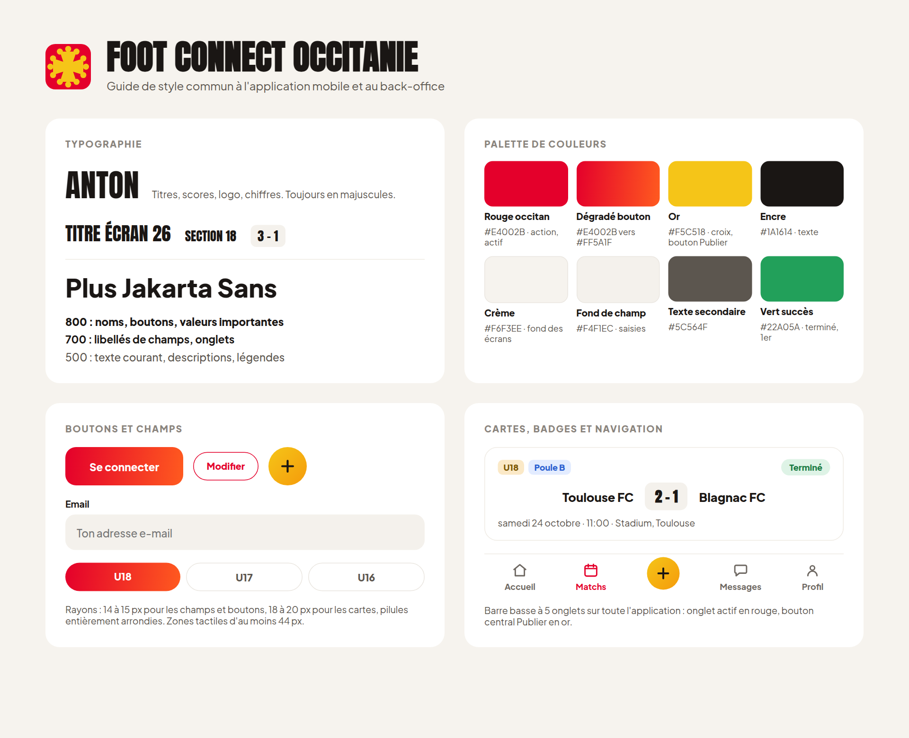

| Élément | Choix | Usage |
| --- | --- | --- |
| Police des titres | **Anton** (Google Fonts), toujours en majuscules | Titres d'écran, scores, logo, chiffres |
| Police de l'interface | **Plus Jakarta Sans** (Google Fonts), graisses 400 à 800 | Textes, boutons, libellés |
| Couleur primaire | Rouge occitan `#E4002B`, dégradé bouton `#E4002B → #FF5A1F` | Boutons principaux, onglet actif, liens |
| Couleur d'accent | Or `#F5C518` | Croix occitane, bouton central « Publier » |
| Fonds | Crème `#F6F3EE` (écrans), `#F4F1EC` (champs), blanc (cartes) | |
| Texte | Encre `#1A1614`, secondaire `#5C564F` | Contraste conforme aux recommandations d'accessibilité |
| Succès | Vert `#22A05A` | Match terminé, 1er du classement |

**Composants homogènes :** boutons principaux de 54 px de haut à coins arrondis (15 px) ; boutons secondaires en pilule bordée de rouge ; champs de 50 px sur fond `#F4F1EC` ; cartes blanches arrondies (18 à 20 px) ; pilules de filtre (active en dégradé rouge, inactive bordée de gris) ; badges de catégorie (or) et de poule (bleu) ; barre de navigation basse à 5 onglets identique sur tous les écrans. Le back-office réutilise les mêmes couleurs et polices. Aucune bibliothèque CSS n'est utilisée : les styles sont écrits avec `StyleSheet` de React Native et du CSS simple dans le back-office, ce qui permet de reproduire exactement la maquette.

### 8.2 Écrans de l'application mobile

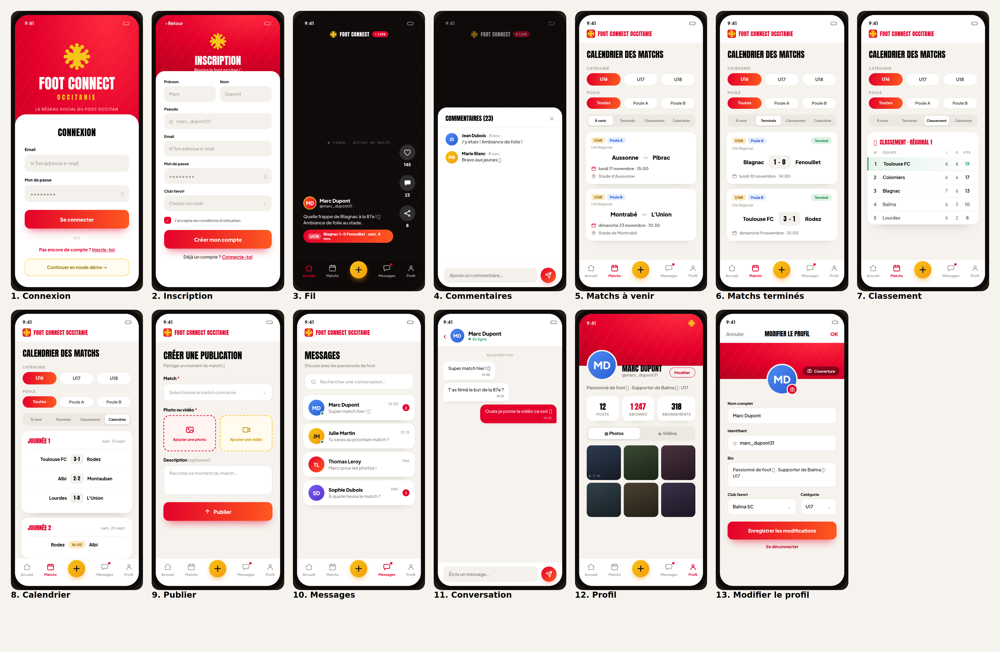

| # | Écran | Rôle | User stories |
| --- | --- | --- | --- |
| 1 | Connexion | Entrée dans l'appli | US3, US4 |
| 2 | Inscription | Créer un compte avec acceptation des CGU | US1 |
| 3 | Fil d'actualité | Photos et vidéos de match, like, partage | US9 |
| 4 | Commentaires | Lire et écrire des commentaires | US9 |
| 5 à 8 | Matchs : à venir, terminés, classement, calendrier | Suivre sa catégorie et sa poule | US6, US7 |
| 9 | Publier | Publier des photos ou une vidéo liées à un match | US8 |
| 10, 11 | Messages et conversation | Messagerie privée | US11 |
| 12, 13 | Profil et modification | Profil, abonnés, réglages | US5, US10 |

Les 13 écrans sont visibles dans le lien ci-dessus et dans le dossier `docs/portfolio/maquettes/` du dépôt (`sprint4-01-connexion.png` à `sprint4-13-modifier-profil.png`).

### 8.3 Compléments : back-office (desktop) et états particuliers (mobile)

**Back-office — saisie des scores**

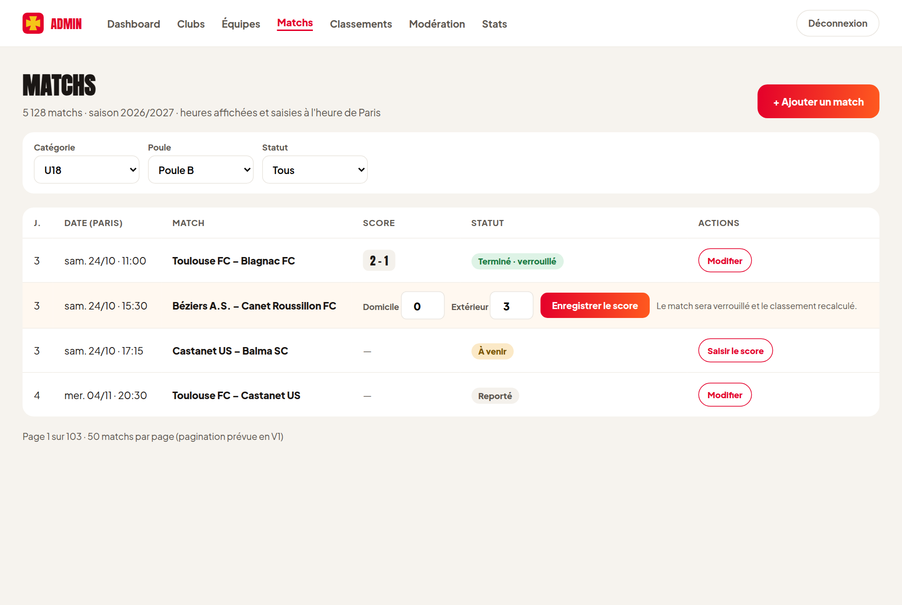

**Back-office — modération, avec son état vide**

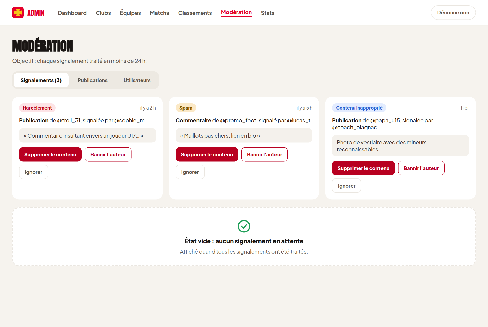

**Mobile — fil vide, erreur réseau, vérification de l'email (V1), publication sans match refusée (V1)**

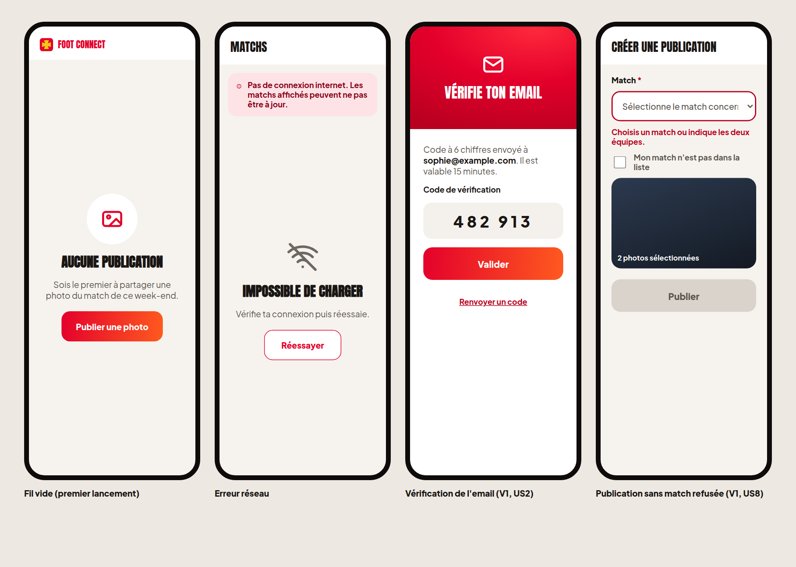

Le back-office est une application web adaptée aux écrans d'ordinateur, de tablette et de téléphone (menu qui passe à la ligne, tableaux qui défilent horizontalement).

### 8.4 Parcours utilisateurs principaux

1. **Un parent publie les photos du match de son enfant :** Inscription → Fil → bouton « + » → Publier (choix du match, photos, légende) → le post apparaît en tête du fil → les autres familles likent et commentent → un coach lui écrit en message privé.
2. **Un supporter suit sa poule :** Matchs → choix de la catégorie et de la poule → À venir (date, heure, stade) → Terminés (score) → Classement.
3. **L'administrateur met à jour les résultats :** connexion au back-office → Matchs → saisie du score → le match est verrouillé et le classement recalculé → Modération → Stats.

Le prototype cliquable (lien ci-dessus, cadre « Prototype cliquable ») permet de parcourir les écrans mobiles : connexion, inscription, fil, like, commentaires, matchs avec filtres et onglets, publication, messages, conversation, profil et modification.

### 8.5 De la maquette à l'application réelle

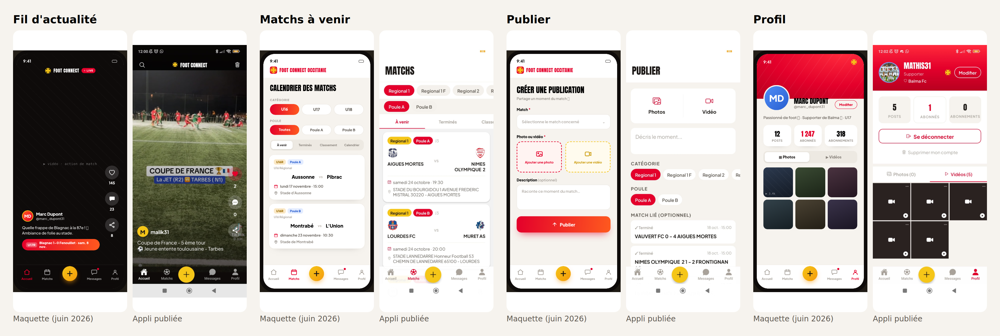

L'identité visuelle a été conservée (couleurs, polices, barre de navigation, bouton « Publier » doré). Plusieurs écrans ont évolué pendant le développement :

| Écran | Dans la maquette | Dans l'appli | Pourquoi |
| --- | --- | --- | --- |
| Connexion | Bouton « Continuer en mode démo » | Supprimé ; ajout de « Mot de passe oublié » et de l'affichage du mot de passe | Pas de contenu sans compte ; demandes des utilisateurs |
| Inscription | Prénom, nom, pseudo, email, mot de passe, club favori | Pseudo, email, mot de passe, rôle sportif (joueur, coach, supporter…), CGU | Inscription plus rapide ; le rôle sert à adapter l'appli (coachs en V1) |
| Fil | Badge « LIVE », légende avec le match | Loupe de recherche ajoutée, badge LIVE retiré | Pas de direct dans le périmètre ; la recherche est devenue nécessaire avec le nombre de posts |
| Matchs | Catégories U16 / U17 / U18 | Toutes les catégories importées (U14 à Seniors, Régional 1 à 3, féminines), logos des clubs, adresse du stade | Les vrais calendriers FFF couvrent bien plus de compétitions |
| Publier | Liste de matchs unique, une zone photo et une zone vidéo | Choix de la catégorie puis de la poule, plusieurs photos (carrousel), saisie manuelle des équipes si le match n'est pas dans la liste | Plus de 5 000 matchs : la liste unique était inutilisable ; certains matchs manquent dans les calendriers |
| Profil | Bio, compteurs, photos et vidéos | Rôle et club affichés, abonnés cliquables, bouton « Se déconnecter » et « Supprimer mon compte » | Exigences d'Apple (suppression du compte) ; consultation des abonnés |
| Signaler / bloquer | Absent | Menu « … » sur chaque post et chaque profil | Exigence d'Apple pour les contenus publiés par les utilisateurs |
| Back-office | Non maquetté au départ | Conçu directement en code, maquetté en novembre 2026 | Outil interne d'un seul administrateur ; priorité donnée à l'appli publique |
